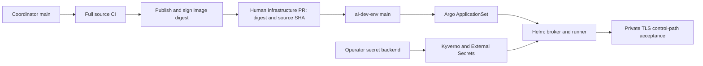

# Coordinator deployment and self-hosting decisions

**Status:** private beta.5 candidate prepared, not published, deployed or accepted. Historical October12–13 observations below are not current-source/artifact/operator acceptance, including the service-owned database configuration cutover. This documentation task runs no gates, accesses no production and performs no automatic deployment/activation.

## Current PostgreSQL-first private beta decision

One application/source tree has separate broker coordinator and isolated runner runtimes. Pi/OMP plugin integration owns host SDK sessions; `src/agent/` provides their session control, not broker coordination. `src/mcp.ts` owns transport: stateless broker/runner MCP2026-07-28 and separate stateful interactive agent MCP2025-11-25. No separate session-control package is required. Root `pnpm build` emits real `dist/agent/*.js` modules/declarations and bundles `dist/plugins/plugin.js` and `dist/plugins/runner-plugin.js`.

Product source owns `prisma/contract.prisma`, generated Effect/Kysely contracts, **one initial PostgreSQL migration** and the generic chart. Operator Git owns credential references, private network/TLS, physical storage/backup and reviewed artifact promotion. Broker and runner use separate PostgreSQL18 databases/logins supplied as role-specific `COORDINATOR_DATABASE_URL` secret environments; `src/database-service.ts` owns redacted connection acceptance and a single session-advisory-fenced Kysely connection, `src/database.ts` schema readiness and `src/dispatch-store.ts` durable `dispatch_queue`. Native Kubernetes key `database.url` injects the URL via secretKeyRef into each role's runtime/migration init, never application URL files or config JSON. Paired offline recovery reads the distinct runner URL as `COORDINATOR_RUNNER_DATABASE_URL`; tests use independent `COORDINATOR_TEST_POSTGRES_URL`. Native PostgreSQL tooling keeps scoped0600 pgpass authentication from its owning service; database secrets are excluded from native agent/model/provider children, Git, irrelevant subprocesses and recovery artifacts. Generated storage/profile identity, concrete tables and recovery readiness determine startup compatibility; Prisma tooling owns history. No alternate backend, importer, old migration timeline, second pool or automatic reconnect/retry is supported.

### Cutover and acceptance boundary

Close submissions/releases at every client, suspend reconciliation/acceptance, inspect tasks and actual owned children, drain and stop owners without clearing HELD/occupied uncertainty. Build/install all CLI/plugin/runner-extension/compiled consumers and replace owned methods/resources/metadata/config/state with `agent.*`, `agent://`, `io.coordinator.agent/*`, `AgentConfig`/`COORDINATOR_AGENT_CONFIG`, agent-prefixed files and `agentBinding`/`agentRunId`/`agentCursor`. Owner files are `agent.token`, `agent-config.json`, `agent-endpoint.json`; plugin state is `agent-<digest>`. No aliases/old-name acceptance/automatic metadata rewrite; upstream SDK names remain untouched.

Initialize fresh separate PostgreSQL databases with the initial attested schema. Fully restart/reload matching broker, runner and every Pi/OMP client; a build/link does not reload an existing TUI. Prove source/protocol/agent identity, TLS/auth, no-dispatch route, physical child isolation and no-replay before explicitly reopening work. No local build/docs update authorizes live data conversion or activation. [Operator guide](self-hosting.md#6-client-upgrades-and-maintenance).

Database ownership loss fences DB serving/writes/readiness while cheap liveness stays200 and admitted work survives until validated completion. Drain before restart; local kernel ownership loss remains hard. Protected v3 paired recovery binds PostgreSQL dumps to runner files, excludes credentials and holds uncertain accepted work; partial targets stay fenced. Git rollback, CNPG backups, PVC retention and Argo Healthy are not paired recovery or external-effect rollback.

### Current gate ledger (requirements, not unobserved success)

| Gate | Required evidence |
| --- | --- |
| Contracts/modules | Regenerate committed contracts, build actual ESM agent modules/declarations and plugin bundles, import generated ESM and prove no drift/types for the intended source. |
| Source/hosts | Unfiltered serial suite and actual pinned Pi1.0.4/OMP18.6.1 fixtures under UID1000/six capabilities/no FOWNER/NoNewPrivs/private HOME. Preserve real Node/tsx child boundaries. |
| Image/chart | Same-source successful CI producer gates, repeated initial-schema application/startup in the exact UID1000/cap0 image, verified digest/signature/SLSA source and chart checksum/OCI identity. |
| Operator | Fresh install, verified private TLS/auth/unknown-CA/hostname rejection, real no-dispatch route, selected provider/runner isolation, all credential/CA rotations with owner/client restarts, restart/no-replay and protected off-cluster paired restore. |
| Promotion | Reviewed chart/image/source pins in operator Git, actual reconciliation and private-route acceptance; no automatic merge/deploy or activation. |
| Public release | MIT/notices/history/native-binary/transitive review, anonymous source/image/chart access and tested platform claims are separate owner gates. |

Pre-rename records report122/122 tests across18 files with zero skips and stock-host smoke56 local fixture calls/zero external. Earlier ownership-loss proof recorded admitted completion with ready503/live200 then restart HELD/no replay; paired PG recovery retained files/occupied uncertainty and launched nothing. Earlier protocol proof observed first SSE progress264.34ms, eight completions/peak nine in-flight/628ms elapsed and cleanup. These are historical fixtures, not renamed gates, sustained throughput, terminal-pixel proof, real-provider acceptance or production evidence.

Historical [beta.3 publication](https://github.com/samuelho-dev/coordinator/actions/runs/38388115672) completed private [v0.2.0-beta.3](https://github.com/samuelho-dev/coordinator/releases/tag/v0.2.0-beta.3); it does not certify the unpublished semantic cutover. Generic bootstrap/config/Helm examples must be re-exercised at the intended source; no fixture result may substitute for exact-source normal CI.

## Release and security decisions

Retain CI → signed immutable image/chart → reviewed operator Git PR → Argo reconciliation → private control-path acceptance. Build once and promote the same digest; source SHA, image digest, chart archive checksum and chart OCI digest are distinct coupled identities. Verify expected signer/issuer/workflow and attested repository/commit, not merely a valid signature. Neither a digest nor a signature proves schema safety, latency, authorization or correct execution.

Git owns desired manifests, exact artifact pins, non-secret config and Secret/storage/TLS references. Runtime rows, files, execution state and secret bytes are not Git desired state. Self-heal is resource reconciliation, not container filesystem integrity scanning. Suspend reconciliation at its actual Application/ApplicationSet owner for maintenance; imperative scale-to-zero is not durable under self-heal. Recreate/RWO alone are not fencing, Retain/prune protection are not backups, and image/Git rollback does not undo data or external effects. One owner per role/database and explicit downtime remain required; no HPA/active-active/HA promise.

Portable installs accept operator-owned existing Secrets and private TLS without mandatory 1Password, Garage, Cilium/Tailscale CRDs or upstream identities; provider overlays still own equivalent isolation. Secret base64 is not encryption, and pod-create privileges can expose mounted secrets. Preserve supervisor/child capabilities and do not weaken security to satisfy a preferred admission profile. Chart values checksums do not hash live Secret bytes. Credential and trust rotation require controlled restaging and **all** owner/client restarts; projected Secret refresh alone reloads neither config nor Node trust.

Keep trusted publication separate from untrusted PR/fork checks. Privileged `pull_request_target`/`workflow_run` jobs must not execute an untrusted checkout. Promotion must bind the actual immutable event-main revision and independently fetched current proposal, not reuse an old run's mutable PR association; workflow_run head SHA is not necessarily event github.sha. Default contents-read and scope package-write/PR-write to owning trusted jobs; use isolated runners and pinned actions. Public fork signers are not upstream signers.

MIT is selected, but public repository/image/chart visibility and redistribution review remain separate. Revised images omit the historical complete Git bundle; old bundles/images and source history still require their own audit. Versioned root source install/build/link is a valid client distribution boundary; public npm publication is not required. Declare only actually tested Linux amd64 execution and pinned host SDKs, not ARM/Windows/macOS runner support by inference. [LICENSE](../LICENSE), [notices](../THIRD_PARTY_NOTICES.md), [CI](../.github/workflows/ci.yaml), [release workflow](../.github/workflows/release.yaml).

## Historical operator provisioning and physical storage

Historical live homelab broker database/role `coordinator`, runner `coordinator_runner` and reserved inactive `coordinator_beta` were separately credentialed under CNPG `cloudnative-pg/coordinator-beta`; these are operator facts, not public defaults. Preserve the owned Dev/coordinator-beta fields and production overrides, private network/HBA/Cilium identities and public ca.crt; no direct Mac SQL path is required for plugin access. Existing Mac broker/plugin/Tailscale/Orca routes and unrelated ACL grants are out of scope.

Historical [PR1297](https://github.com/samuelho-dev/ai-dev-env/pull/1297), [exact-main CI38362192158](https://github.com/samuelho-dev/ai-dev-env/actions/runs/38362192158) and approved [bootstrap38364590812](https://github.com/samuelho-dev/ai-dev-env/actions/runs/38364590812) passed without beta activation. Then-observed nine fields/B2 authentication are not proof of the later13-field requirement or database/restore/deployment acceptance. Three independent username/password pairs plus five existing tokens and two backup fields make13. Private source Reader is environment-only in coordinator-beta-promotion, never repository-wide; artifact Actions read grants remain independently scoped. The observed environment allowed main branch, not tags, with no required reviewers; main was unprotected. These are historical governance gaps, not current enforcement claims. Owner review remains required until enforcement is proven.

Required homelab-cp affinity/control-plane toleration excludes bulk ordinary-worker CI/DIND, **not every CI workload**: capacity-one maintenance CI was still placed on CP. Single-instance CNPG unsupervised updates/local-path share CP root I/O with etcd/other work; this is not dedicated disk, physical isolation, HA or a proven poll-timeout fix. A new namespace/PVC does not reserve bandwidth. Production needs measured physical storage/latency/durability/recovery acceptance; no CI placement or production change occurs here.

Historical route checks recorded health134ms, session.list3209ms and isolated polls57–63ms with no offers and scoped cleanup; proxy cancellations/TCP-open timeout were seen. The original failed request was not captured: these observations cannot identify its cause or prove recovery. Cheap liveness, owned DB readiness and authenticated protocol acceptance remain different evidence.

## Historical October12 Kubernetes GitOps process

Read-only live inspection of the Argo Application, Deployments, Pods, PVC metadata and admission policy recorded `coordinator-homelab` as **Synced / Healthy** at infrastructure revision `1251cf5d9c8a1cac7d5304a455263d623b162814`. Both broker and runner have one Ready replica, zero container restarts, `Recreate`, and the image/source pair above. This verifies deployed identity and controller state, not every runtime dependency.

The final acceptance step is a documented/manual operation today, not an automated source-workflow or chart post-sync gate. The observed promotion is [ai-dev-env PR #1296](https://github.com/samuelho-dev/ai-dev-env/pull/1296); its [acceptance comment](https://github.com/samuelho-dev/ai-dev-env/pull/1296#issuecomment-6131932485) records authenticated routes, isolated polls and zero occupied work at that rollout. That historical occupied-state observation is not a claim about current task occupancy.

| Layer | Investigation-time configuration | Gap or boundary |
| --- | --- | --- |
| Chart ownership | Private infrastructure-local [Coordinator chart](https://github.com/samuelho-dev/ai-dev-env/tree/1251cf5d9c8a1cac7d5304a455263d623b162814/deploy/helm/applications/cicd/coordinator); chart/appVersion `1.0.0`, common dependency `1.6.1`. Only common/devpod library charts are published by the inspected infrastructure publisher. | Coordinator itself is not a published chart artifact. Chart/appVersion does not identify the deployed application revision. |
| Promotion | Human PR changes `image.digest` and `sourceSha`. Both source and infrastructure GitHub branch APIs report unprotected `main`, with no required checks. | No Coordinator-specific required promotion gate was found. Human verification is not an enforced merge check. |
| Reconciliation | [Infrastructure ApplicationSet](https://github.com/samuelho-dev/ai-dev-env/blob/1251cf5d9c8a1cac7d5304a455263d623b162814/deploy/argocd/homelab/applicationsets/infrastructure.yaml) tracks Git `main`; live Application has automatic sync, self-heal, prune, `allowEmpty:false`, five retries and server-side apply. ApplicationSet declares `create-update`. | Generator removal does not itself delete the child Application under that policy. Separate child-Application sync waves do not prove prerequisite readiness. |
| Drift ownership | Live comparison ignores PVC `volumeName`, Tailscale-managed egress `externalName`, and selected Deployment pod-level security-context fields; `RespectIgnoreDifferences=true`. | Generated provider fields need explicit controller ownership. Review/narrow the security-context exclusions: ignored fields can hide an intended deployment change; self-heal is not a claim that every field is Git-enforced. |
| Admission | Live `verify-image-provenance` is fail-closed/Enforce, checks internal GHCR signatures and main-workflow SLSA-v1 attestations. | Its identity patterns trust the maintainer namespace broadly, and predicate conditions check build type/nonempty invocation—not equality of attested repository/commit with this release's `sourceSha`. Require exact producer/source equality at promotion; the runner's bundle/SHA startup check is complementary. |
| Enrollment | Central registry → Kyverno-generated ExternalSecrets → ESO/1Password → namespaced Secrets → root init staging of UID-1000 mode-0600 `/config` files. Secret rotation uses existing Kyverno/reloader mechanisms; Helm checksum hashes values, not live Secret bytes. | This depends on preinstalled provider controllers/store and operator credentials. Secret bytes are outside Git; their references/controller configuration must be declared. |
| Bootstrap race | The internal runbook gates policy/store readiness, then uses an imperative Namespace timestamp annotation to retrigger secret generation for an existing namespace. | This manual backfill is an exception to fully declarative delivery. Replace the untracked desired annotation with a reviewed enrollment revision in Git after prerequisites are ready; do not bypass it with plaintext/manual Secrets or assume child sync waves solve it. |
| Network | Private Tailscale ingress/TLS plus egress proxies, explicit socket-DNS overrides preserving SNI/certificate checks, and Kubernetes/Cilium policies; private auth-broker and Garage dependencies. | Externally successful health/poll is a separate acceptance gate. Consumers need their own identities/private network, not the maintainer's Tailnet/Mac/auth service. |
| Persistence | Broker `coordinator-raw` and snapshot claims, runner `coordinator-runner`; all live claims are Bound, local-path/RWO and node-selected to `homelab-worker-2`. | RWO is not single-Pod ownership; local-PV recovery depends on the node. Retention does not establish HA or seamless active-work migration. |
| Deletion/backup selection | PVCs have `keep`, `Prune=false`, `IgnoreExtraneous`; broker/runner volumes and credentials are excluded from Velero. One unmounted legacy snapshot claim remains intentionally retained. | Prune protection/retention is not backup, and application deletion/reclaim behavior needs its own review. Do not delete the retained claim during this research or assume Velero covers runner state. |

**Local-checkout trap:** the inspected infrastructure checkout still has the older `96f905…` source and `sha256:92035b…` defaults. The merged promotion and independently observed live Application are newer. Do not render/apply that local checkout's defaults and accidentally downgrade; use the reviewed desired revision or explicit current pins.

## Hindsight upstream comparison: release and runtime contracts

**Scope/version:** read-only primary-source research on 2026-10-12; deployed release `0.10.3` maps to upstream tag `v0.10.3`, commit `eb6df499d35300e5b2f3f029b2e6adda04ed90f8`. Current `main` resolved to `f843f173bb41f001e322cc83c917371639e47fbf`; do not treat moving documentation as the deployed contract. The inspected installation/monitoring docs, tenant-auth implementation, worker poller, migration runner, admin backup/restore implementation and Chart.yaml were unchanged between those two revisions. This does not assert every upstream file or deployed customization is identical. [H1–H12]

### Public artifacts: stronger evidence than a repository or placeholder README

- **Fact:** upstream is MIT-licensed, with copyright/permission-notice retention required and an explicit no-warranty clause; public self-hosting has a real reuse license, not merely public source. [H1]
- **Fact:** GitHub release `v0.10.3` is published, non-draft/non-prerelease (2026-10-08), and lists `hindsight-0.10.3.tgz`, platform CLI binaries, Python packages and publication attestations. Chart.yaml has chart version and appVersion `0.10.3`. [H2][H3]
- **Fact:** canonical installation docs name `oci://ghcr.io/vectorize-io/charts/hindsight`; the release workflow actually packages and pushes `helm/hindsight` to GHCR OCI and attaches the chart to the release. That is more specific than the Helm README's placeholder repository examples. [H4][H5]
- **Observed access, not inferred publication:** anonymous GHCR manifest requests returned HTTP 200 for `vectorize-io/charts/hindsight:0.10.3`, `vectorize-io/hindsight-api:0.10.3` and `vectorize-io/hindsight-control-plane:0.10.3`. Only manifests/headers were read; no chart content layers, image pulls, registry login, signature verification or installation occurred. [H13]
- Chart manifest digest: `sha256:a9da3196ad3ee58605768eb1db7ac862484751cb1932f822dd3afdb311a2b30d`; its config/layer media types identify a Helm chart and its annotation version is `0.10.3`. API/control-plane index digests were respectively `sha256:f80f304db313cbc8775acd601fda7d094f5854ebf9bc252d8134eb9276d56b40` and `sha256:bf436b78e85b0438afda8d2e4b1fce01b9d12f135a742d1cc276b741766f212d`. These are observed registry identities, not proof that live Pods use those exact digests. [H13]
- **Fact:** release source builds/pushes amd64 and arm64 images, assigns semver aliases and signs image digests with Cosign; docs provide verification instructions. **Boundary:** publication/signing code and attached Python attestations do not prove a particular running image/chart has been independently verified. [H5]
- **Coordinator applicability:** publish exact chart/image coordinates and version matrix, then independently establish anonymous access and producer identity. Pin digest-based promotion; do not copy quickstart `latest`, moving semver aliases, or placeholder install coordinates into the supported GitOps contract.

### Configuration and operator-owned persistence

- **Fact:** canonical installation distinguishes development pg0 (embedded PostgreSQL, not recommended for production) from production external PostgreSQL. Helm can instead deploy its own PostgreSQL; these are three different lifecycle/backup choices, not interchangeable storage guarantees. [H4][H6]
- **Documentation caveat:** installation says PostgreSQL 14+; storage docs say PostgreSQL 15+ and pgvector 0.5.0+. Report this mismatch rather than invent a reconciled support floor; Coordinator should publish one tested compatibility matrix. [H4][H6]
- **Fact:** `existingSecret` injects environment variables into API/workers, with explicit `postgres-password` lookup for external DB mode. Templates disable API's internal worker when dedicated workers are enabled. [H7]
- **Important source-level boundary:** the DB URL helper consumes top-level `databaseUrl`; otherwise it constructs a bundled/external PostgreSQL URL. Bundled mode interpolates `.Values.postgresql.auth.password` into the Deployment URL. An `existingSecret` reference alone therefore does not eliminate bundled DB credentials from rendered workload configuration. The installation example's `api.database.url` is not the helper's consumed override. [H4][H7]
- **Do not copy defaults:** bundled PostgreSQL uses `ankane/pgvector:latest` and sample/default credentials; inline LLM key/password examples are onboarding samples, not a safe GitOps secret-provisioning path. Coordinator should reference operator-created Secrets and document the actual keys/precedence, without plaintext secret values or upstream-private secret-manager dependencies. [H7]
- **Coordinator applicability:** reuse explicit configuration ownership and separation from artifacts; retain its singleton session-advisory ownership and runner file fencing instead of importing PostgreSQL's replica/rolling-update assumptions.

### Worker durability is a database-backed contract, not exactly-once external execution

- **Fact:** API is described as stateless with PostgreSQL-backed state; dedicated `hindsight-worker` uses the API image/package and polls PostgreSQL as its broker. Small production may retain the internal worker; high throughput can separate/scalably replicate workers. [H8]
- **Fact:** PostgreSQL claiming uses transactions and `FOR UPDATE SKIP LOCKED`, then persists `processing`, `worker_id` and `claimed_at`. Worker StatefulSet supplies stable Pod-name identity; restart recovery recognizes its own prior claims. This is durable ownership, not just an in-memory queue. [H9]
- **Fact:** defaults document three retries and 60-second transient-failure backoff; the poller explicitly distinguishes retry, intentional deferral, unexpected failure and terminal-status-write retry. Backpressure deferrals do not consume the retry budget. Recovery can return processing rows to pending or fail them when the retry budget is exhausted. [H9][H10]
- **Fact:** terminal-status writes retry with backoff; after a 300-second deadline the worker shuts down so restart recovery can reclaim the row. The executor and completion write are separate phases: transaction-safe claiming alone cannot prove an externally completed effect will never be replayed. [H9]
- **Fact:** upstream documents worker inspection and decommissioning before scale-down; fleet-wide decommission releases healthy workers' processing tasks too and is explicitly disruptive. Stable identities and graceful shutdown do not make arbitrary force removal safe. [H8][H11]
- **Coordinator applicability/recommendation:** reuse persisted ownership/status, bounded retry classification and explicit recovery tooling only where compatible with its acceptance/ack protocol. Do **not** automatically retry accepted model/remote-runner work merely because the broker lost its result write or restored an old snapshot; require proven idempotency or explicit reconciliation of uncertain external completion. Hindsight's background memory-processing retry policy is not that proof.

### Health, authentication and application acceptance are separate boundaries

- **Fact:** `/health/live` answers from the process without database I/O; `/health` and `/health/ready` check initialization, acquire a pooled DB connection and run `SELECT 1`, returning 200/503 according to readiness. Worker endpoints make the same liveness/readiness distinction. [H8][H12]
- **Fact:** these API health handlers have no request-context/auth dependency. Tenant authentication is instead enforced by the engine's configured tenant extension; the default extension accepts requests without authentication. Built-in `ApiKeyTenantExtension` requires its configured key, and MCP auth can be separately disabled. A successful health response therefore does not prove authorization enforcement. [H12]
- **Coordinator applicability:** Hindsight's DB-dependent readiness is stronger than a static status-only response, but neither proves embedding/LLM reachability, retain/recall/reflect completion, TLS/network isolation or credential rejection. Keep cheap unauthenticated liveness separate from DB readiness and a separately authenticated, non-mutating authorization check; use a disposable acceptance environment for any mutating task/model smoke.

### Migrations and backup/restore do not follow an image rollback automatically

- **Fact:** startup migrations use Alembic upgrades under process serialization and PostgreSQL session advisory locks; a direct migration DB URL can bypass transaction-mode poolers that break session-lock ownership. Older code encountering a newer unknown DB revision skips migrations with a warning, not a downgrade. That behavior is not a guarantee that old code understands the new schema. [H10]
- **Fact:** `hindsight-admin backup` uses binary table COPY within a `REPEATABLE READ` transaction for a specified schema, including `async_operations` and operational tables. Restore validates archive/schema compatibility before a transaction that truncates and imports target tables; docs warn that target data is deleted. It is a logical application-schema backup, not a PostgreSQL cluster/PITR/role/configuration backup. [H11]
- **Boundary/inference from implementation:** backup walks enumerated PostgreSQL tables; external S3/GCS/Azure file bytes are outside that table-copy loop and need their own recovery policy. Extension-owned tables also require declared inclusion; restoring pending/processing operations can resurrect earlier work ownership. Operator Secrets, external stores and backup encryption/retention are not supplied by a chart PVC. [H10][H11]
- **Coordinator applicability:** document a protected PostgreSQL-plus-runner-file paired backup, compatible image/schema pairing, a fenced/quiesced restore and explicit external-work reconciliation. Reuse the distinction between recovery backup and portable bank/task export; do not translate a Git digest revert into a claim of database rollback or safe replay.

### Hindsight primary-source references

All file citations below are pinned to deployed upstream release commit `eb6df499d35300e5b2f3f029b2e6adda04ed90f8`; current-main comparison is pinned above. Registry observations are time-specific anonymous metadata reads, not release execution.

- **H1:** [LICENSE L1–20](https://github.com/vectorize-io/hindsight/blob/eb6df499d35300e5b2f3f029b2e6adda04ed90f8/LICENSE#L1-L20).
- **H2:** [Published v0.10.3 release](https://github.com/vectorize-io/hindsight/releases/tag/v0.10.3) and [release metadata API](https://api.github.com/repos/vectorize-io/hindsight/releases/tags/v0.10.3).
- **H3:** [Chart.yaml L1–6](https://github.com/vectorize-io/hindsight/blob/eb6df499d35300e5b2f3f029b2e6adda04ed90f8/helm/hindsight/Chart.yaml#L1-L6).
- **H4:** [Canonical installation L26–45, L148–218](https://github.com/vectorize-io/hindsight/blob/eb6df499d35300e5b2f3f029b2e6adda04ed90f8/hindsight-docs/docs/developer/installation.md#L26-L218).
- **H5:** [Release image/signing/chart jobs L436–550](https://github.com/vectorize-io/hindsight/blob/eb6df499d35300e5b2f3f029b2e6adda04ed90f8/.github/workflows/release.yml#L436-L550), [release chart attachment L615–648](https://github.com/vectorize-io/hindsight/blob/eb6df499d35300e5b2f3f029b2e6adda04ed90f8/.github/workflows/release.yml#L615-L648).
- **H6:** [Storage/development/production requirements L47–85](https://github.com/vectorize-io/hindsight/blob/eb6df499d35300e5b2f3f029b2e6adda04ed90f8/hindsight-docs/docs/developer/storage.md#L47-L85).
- **H7:** [values existingSecret L7–14](https://github.com/vectorize-io/hindsight/blob/eb6df499d35300e5b2f3f029b2e6adda04ed90f8/helm/hindsight/values.yaml#L7-L14), [bundled DB defaults L324–362](https://github.com/vectorize-io/hindsight/blob/eb6df499d35300e5b2f3f029b2e6adda04ed90f8/helm/hindsight/values.yaml#L324-L362), [URL helper L110–120](https://github.com/vectorize-io/hindsight/blob/eb6df499d35300e5b2f3f029b2e6adda04ed90f8/helm/hindsight/templates/_helpers.tpl#L110-L120), [API env wiring L46–65](https://github.com/vectorize-io/hindsight/blob/eb6df499d35300e5b2f3f029b2e6adda04ed90f8/helm/hindsight/templates/api-deployment.yaml#L46-L65).
- **H8:** [Service roles and scaling L22–60](https://github.com/vectorize-io/hindsight/blob/eb6df499d35300e5b2f3f029b2e6adda04ed90f8/hindsight-docs/docs/developer/services.md#L22-L60).
- **H9:** [Worker transactional claim L715–750](https://github.com/vectorize-io/hindsight/blob/eb6df499d35300e5b2f3f029b2e6adda04ed90f8/hindsight-api-slim/hindsight_api/worker/poller.py#L715-L750), [retry/terminal-write/recovery L1232–1450](https://github.com/vectorize-io/hindsight/blob/eb6df499d35300e5b2f3f029b2e6adda04ed90f8/hindsight-api-slim/hindsight_api/worker/poller.py#L1232-L1450), [SQL ownership L1948–1968](https://github.com/vectorize-io/hindsight/blob/eb6df499d35300e5b2f3f029b2e6adda04ed90f8/hindsight-api-slim/hindsight_api/engine/db/ops_postgresql.py#L1948-L1968), [stable worker identity L39–65](https://github.com/vectorize-io/hindsight/blob/eb6df499d35300e5b2f3f029b2e6adda04ed90f8/helm/hindsight/templates/worker-statefulset.yaml#L39-L65).
- **H10:** [Configuration migration URL L26–30](https://github.com/vectorize-io/hindsight/blob/eb6df499d35300e5b2f3f029b2e6adda04ed90f8/hindsight-docs/docs/developer/configuration.mdx#L26-L30), [file stores L2166–2188](https://github.com/vectorize-io/hindsight/blob/eb6df499d35300e5b2f3f029b2e6adda04ed90f8/hindsight-docs/docs/developer/configuration.mdx#L2166-L2188), [worker settings L2447–2453](https://github.com/vectorize-io/hindsight/blob/eb6df499d35300e5b2f3f029b2e6adda04ed90f8/hindsight-docs/docs/developer/configuration.mdx#L2447-L2453), [migration upgrade/newer-revision handling L330–349](https://github.com/vectorize-io/hindsight/blob/eb6df499d35300e5b2f3f029b2e6adda04ed90f8/hindsight-api-slim/hindsight_api/migrations.py#L330-L349), [direct URL/advisory locks L453–619](https://github.com/vectorize-io/hindsight/blob/eb6df499d35300e5b2f3f029b2e6adda04ed90f8/hindsight-api-slim/hindsight_api/migrations.py#L453-L619).
- **H11:** [Admin backup/restore/decommission docs L190–359](https://github.com/vectorize-io/hindsight/blob/eb6df499d35300e5b2f3f029b2e6adda04ed90f8/hindsight-docs/docs/developer/admin-cli.md#L190-L359), [table inventory L49–85 and extension inclusion L297–310](https://github.com/vectorize-io/hindsight/blob/eb6df499d35300e5b2f3f029b2e6adda04ed90f8/hindsight-api-slim/hindsight_api/admin/cli.py#L49-L310), [transactional backup/restore L336–473](https://github.com/vectorize-io/hindsight/blob/eb6df499d35300e5b2f3f029b2e6adda04ed90f8/hindsight-api-slim/hindsight_api/admin/cli.py#L336-L473).
- **H12:** [Probe docs L50–98](https://github.com/vectorize-io/hindsight/blob/eb6df499d35300e5b2f3f029b2e6adda04ed90f8/hindsight-docs/docs/developer/monitoring.md#L50-L98), [health handlers L5615–5672](https://github.com/vectorize-io/hindsight/blob/eb6df499d35300e5b2f3f029b2e6adda04ed90f8/hindsight-api-slim/hindsight_api/api/http.py#L5615-L5672), [initialized DB health L6172–6197](https://github.com/vectorize-io/hindsight/blob/eb6df499d35300e5b2f3f029b2e6adda04ed90f8/hindsight-api-slim/hindsight_api/engine/memory_engine.py#L6172-L6197), [default/API-key/MCP authentication L8–90](https://github.com/vectorize-io/hindsight/blob/eb6df499d35300e5b2f3f029b2e6adda04ed90f8/hindsight-api-slim/hindsight_api/extensions/builtin/tenant.py#L8-L90).
- **H13:** Anonymous registry metadata endpoints: [chart manifest](https://ghcr.io/v2/vectorize-io/charts/hindsight/manifests/0.10.3), [API manifest](https://ghcr.io/v2/vectorize-io/hindsight-api/manifests/0.10.3), [control-plane manifest](https://ghcr.io/v2/vectorize-io/hindsight-control-plane/manifests/0.10.3). Standard anonymous scoped bearer challenge was handled without printing token values; these are ordinary registry coordinates, not signed download URLs.

## Current evaluation: Hindsight database options

### PostgreSQL, SQLite and embedded pg0

**Evaluated 2026-10-13:** current public documentation is distinct from the historical deployment comparison above; implementation checks below are pinned to deployed `0.10.3` (`eb6df499d35300e5b2f3f029b2e6adda04ed90f8`). No live cluster, Secret, installation or runtime checks were performed for this evaluation.

- **PostgreSQL: yes; SQLite: no supported backend.** Current [storage documentation](https://hindsight.vectorize.io/developer/storage) names PostgreSQL as primary storage and Oracle AI Database as an enterprise alternative—not SQLite. The pinned [backend factory](https://github.com/vectorize-io/hindsight/blob/eb6df499d35300e5b2f3f029b2e6adda04ed90f8/hindsight-api-slim/hindsight_api/engine/db/__init__.py) accepts only `postgresql` and `oracle`, rejecting other backend names. Oracle is therefore not merely a moving-doc claim, but this inspection does not independently verify its advertised full feature parity.
- **pg0 is PostgreSQL, not SQLite or a database-file compatibility mode.** The docs describe a bundled PostgreSQL server with pgvector; pinned [bootstrap code](https://github.com/vectorize-io/hindsight/blob/eb6df499d35300e5b2f3f029b2e6adda04ed90f8/hindsight-api-slim/hindsight_api/pg0.py) imports `pg0.Pg0`, starts the server and resolves `pg0`/`pg0://` to a PostgreSQL connection URI. Its declared optional dependency is [`pg0-embedded>=0.15.2`](https://github.com/vectorize-io/hindsight/blob/eb6df499d35300e5b2f3f029b2e6adda04ed90f8/hindsight-api-slim/pyproject.toml); a plain slim installation needs the `embedded-db` extra to use it. [Installation docs](https://hindsight.vectorize.io/developer/installation#postgresql) explicitly recommend external PostgreSQL for production, not pg0. Avoid treating the storage page's fixed port/path examples as the exact bootstrap contract: the inspected code permits named instances and auto-assigned ports.
- **Production PostgreSQL requires the selected vector extension.** Installation lists `pgvector` (default), `pgvectorscale`, `vchord`, and `scann` (AlloyDB), selected by `HINDSIGHT_API_VECTOR_EXTENSION`; the pinned [configuration contract](https://github.com/vectorize-io/hindsight/blob/eb6df499d35300e5b2f3f029b2e6adda04ed90f8/hindsight-docs/docs/developer/configuration.mdx#L120-L160) declares the same options and their installation requirements. These are PostgreSQL extension/index choices, not separate SQLite support. **Version-floor discrepancy remains:** current and pinned installation say PostgreSQL **14+**, while current and [pinned storage requirements](https://github.com/vectorize-io/hindsight/blob/eb6df499d35300e5b2f3f029b2e6adda04ed90f8/hindsight-docs/docs/developer/storage.md#L67-L85) say **15+** and pgvector **0.5.0+**. Do not infer verified PostgreSQL 14 compatibility or confuse the Python `pgvector>=0.4.1` package dependency with the server-extension version.
- **Hosting choices retain operator ownership.** The pinned [Helm defaults](https://github.com/vectorize-io/hindsight/blob/eb6df499d35300e5b2f3f029b2e6adda04ed90f8/helm/hindsight/values.yaml#L324-L362) offer chart-managed PostgreSQL or an external server; the [URL helper](https://github.com/vectorize-io/hindsight/blob/eb6df499d35300e5b2f3f029b2e6adda04ed90f8/helm/hindsight/templates/_helpers.tpl#L110-L120) constructs PostgreSQL URLs, not SQLite URLs. Our hosted deployment used external shared CNPG PostgreSQL **16.2**, one ready instance and `local-path` **30 GiB**, with Barman WAL archiving/daily backups and seven-day object retention, according to the **existing 2026-10-12 evidence above**, not a new observation. One instance and a completed backup do not establish HA or a rehearsed restore.
- **Coordinator decision stays separate.** The owner has authorized the isolated PostgreSQL-first Coordinator beta described above; that does not authorize modifying Hindsight or its shared database. PostgreSQL alone supplies neither exactly-once agent execution nor automatic failover, and does not eliminate contention on shared physical storage. Keep migration, independent credentials, backups/restores and execution reconciliation explicitly owned.

## Authorized Coordinator PostgreSQL and generated-schema approach

The published owner generator9.0.2 supplies stable Effect4 and real ESM module specifiers; [PR70](https://github.com/samuelho-dev/prisma-effect-kysely/pull/70), [Node22/24 CI](https://github.com/samuelho-dev/prisma-effect-kysely/actions/runs/38344211739), [release38345704625](https://github.com/samuelho-dev/prisma-effect-kysely/actions/runs/38345704625) and [registry](https://registry.npmjs.org/prisma-effect-kysely/9.0.2) are prior generator evidence, not current application acceptance. Do not copy old infra Effect3/Prisma7 pins or hand-edit generated imports.

Generated types are the stable DB model; validate once at unknown wire/config/filesystem/serialized JSON seams, not typed query rows. Database-owned defaults/native nullable/bigint/boolean/timestamp behavior matter for direct Kysely writes; ORM uuid()/updatedAt behavior must not be assumed. Runtime owns no schema generation/DDL, second pool or library migration tracker. The one initial attested migration creates all role tables; `dispatch_queue` uses queue/payload/failure/available_at/leased_at/lease_id while upstream Effect option names remain upstream contracts. Apply exact committed schema with every owner stopped, separately to each fresh database.

Primary platform sources: [OpenGitOps](https://opengitops.dev/), [Argo sync](https://argo-cd.readthedocs.io/en/stable/user-guide/auto_sync/), [Argo CI integration](https://argo-cd.readthedocs.io/en/stable/user-guide/ci_automation/), [Kubernetes storage](https://kubernetes.io/docs/concepts/storage/persistent-volumes/#access-modes), [Secrets](https://kubernetes.io/docs/concepts/security/secrets-good-practices/), [Cosign verification](https://docs.sigstore.dev/cosign/verifying/verify/), [Helm OCI](https://helm.sh/docs/topics/registries/), [GitHub secure workflows](https://docs.github.com/en/actions/reference/security/secure-use), [PostgreSQL18 backup](https://www.postgresql.org/docs/18/backup.html), [advisory locks](https://www.postgresql.org/docs/18/explicit-locking.html#ADVISORY-LOCKS), [CNPG storage](https://cloudnative-pg.io/docs/1.28/storage/).
