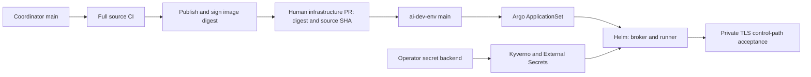

# Coordinator deployment and public self-hosting research

**Decision:** retain the existing CI → signed image → deployment-Git PR → Argo CD path. The Kubernetes deployment is already GitOps-managed; the missing work is release/promotion enforcement, operational acceptance and a portable installation contract—not a new deployment controller.

**Scope:** historical primary-source/read-only observations from October12–13, updated October14 for the authorized complete broker+runner PostgreSQL cutover. **Beta.4 is prepared, unpublished, not deployed or accepted.** Prior beta.3 publication/backend evidence remains historical below; it does not certify current source/image/chart/migration. No live mutation or production/Hindsight/public visibility change is claimed.

## Current PostgreSQL-first private beta decision

The authorized private `0.2.0-beta.4` cutover replaces the existing live `coordinator` broker/homelab runner, not a separate beta activation. Product source owns chart/schema/attested migrations/generated contracts; operator Git owns separate database/role credentials, private network/storage/backup and reviewed promotion. Live broker database/role is `coordinator`, homelab runner `coordinator_runner`; separately credentialed `coordinator_beta` remains reserved and inactive. [Operator guide](self-hosting.md) covers stopped-owner migration, v3 paired PostgreSQL recovery and explicit broker/existing homelab runner legacy import.

**Historical beta.3 release and storage (not beta.4 evidence):** [PR10](https://github.com/samuelho-dev/coordinator/pull/10) merged `88bec0a8761bb87832325b4946d28057d049c54f`; [own-main CI38386088501](https://github.com/samuelho-dev/coordinator/actions/runs/38386088501) and [publication38388115672](https://github.com/samuelho-dev/coordinator/actions/runs/38388115672) completed private [v0.2.0-beta.3](https://github.com/samuelho-dev/coordinator/releases/tag/v0.2.0-beta.3) with immutable signed/attested image/chart coordinates. Native backend PRs1298/1305/1306/1307/1308 observed independent ESO, PG18.6 verify-full TLS/durability, CP PVC/restart, B2 backup/WAL and isolated catalog restore. That is not current runner PG journal/paired-state or application acceptance, disk isolation, power-loss or HA proof. No old pin is beta.4 publication evidence.

* **Database/runtime:** broker and runner both require external PostgreSQL18 with separate databases/logins and canonical private `databaseUrlFile`. Each uses native Effect SQL on one advisory-fenced owner; runner filesystem flock remains. Prisma8 attested contract/migrations include `runner_tasks`/`runner_events`; generated Effect4/Kysely types remain authoritative. No runtime SQLite adapter/dependency/worker, second pool, reconnect/retry or pgvector; only `scripts/import-sqlite.ts` uses offline node:sqlite for legacy migration.
* **Private database:** CNPG `cloudnative-pg/coordinator-beta`, internal RW service `coordinator-beta-rw.cloudnative-pg.svc.cluster.local`, separate live `coordinator`, homelab `coordinator_runner` and inactive reserved `coordinator_beta` database/role pairs. Owned `Dev/coordinator-beta` fields are `production-database-username/password`, `runner-database-username/password`, original `database-username/password`, plus five preexisting tokens and two backup fields:11 core+2 backup=13. Production bearers remain per-field overrides from `Dev/coordinator`. Public ca.crt/TLS/HBA/Cilium remain; no SQL tailnet path. Actual Mac inspection found no Coordinator process/runner and only a buildx builder container: plugin accesses broker, native SDK history is not Coordinator SQLite. Existing Mac broker/plugin/Tailscale8443/Orca6768 routes and unrelated ACL grants stay unchanged.
* **Placement:** required hostname `homelab-cp` plus explicit control-plane NoSchedule toleration excludes bulk CI/DIND on both ordinary CI workers, **not every CI workload**. Operator `github-actions-runners/values.yaml`371–376 places the scoped capacity-one `gha-rs-maintenance` runner on CP with that toleration. Its execution constraints must be resolved/accepted before live beta acceptance; this beta changes no CI placement. Single-instance local-path also shares CP root I/O with etcd/other workloads: **not dedicated disk, all-CI isolation, HA or a guaranteed timeout fix**. Production self-host needs dedicated data node/device or external managed PG with measured latency/durability/recovery; another PVC cannot reserve bandwidth ([CNPG storage](https://cloudnative-pg.io/docs/1.28/storage/)).
* **Artifact/order:** reviewed existing-wrapper policy/trust → narrow environment-only private source Reader/package read grants and preservation-only credential provisioning → exact-source normal CI/private prerelease → reviewed suspended existing-wrapper pins → ESO/internal CNPG/public CA → stopped-owner broker/homelab runner raw SQLite/WAL capture and verified import → drained restart → actual acceptance. No separate beta or Mac SQL activation. Reader remains absent; package read permissions are external prerequisites. `prepare-private` is not promotable; no publication/live migration is claimed.
  **Current promotion security:** the infrastructure `coordinator-beta-promotion` environment was created and its observed custom deployment branch policy allows exactly branch `main`, not tags. It has no required reviewers; main remains unprotected, so recorded owner review is still mandatory. The absent source Reader must be an **environment-only** Secret in this environment, never a repository Secret. Private-package Actions read grants are still external. Corrective promotion preparation removes unnecessary `workflow_dispatch`: contents-only “Coordinator beta proposal data” is separate from the activated-only “Coordinator beta trusted release” environment job; both bind immutable event-main `github.sha` and the same-event PR head through independent fixed fetches. This is guard preparation, not successful promotion or Reader provisioning. The manual main/dev 1Password bootstrap is unchanged.
  **Policy/provisioning evidence:** private infrastructure [PR1297](https://github.com/samuelho-dev/ai-dev-env/pull/1297) passed normal CI and merged at `df650e09c7cfc98920bbf9457f20fcf9a1be00d5`, without beta activation. Exact-main-push [normal CI38362192158](https://github.com/samuelho-dev/ai-dev-env/actions/runs/38362192158) succeeded. Approved Dev bootstrap dispatched once at that SHA; [run38364590812](https://github.com/samuelho-dev/ai-dev-env/actions/runs/38364590812) succeeded with bounded evidence of nine independent `Dev/coordinator-beta` fields saved/read back, vault writes and actual B2 key authentication/prefix `ai-dev-env/postgres/coordinator-beta/`. Observed capabilities: deleteFiles, listAllBucketNames, listBuckets, listFiles, readFiles, writeFiles. Database user `coordinator_beta`, independent256-bit password/five bearer-control tokens and backup key pair were stored without printing values. This proves provisioning/backend scope, not Reader/package grants, database creation, off-cluster restore or deployment.
* **Transport/acceptance:** installed native Effect MCP and official MCP client2.3.1, Streamable HTTP with JSON/SSE responses, not deprecated standalone HTTP+SSE. Preserve streaming, backpressure/cancellation, bounded individual messages, auth/origin/version/media/session boundaries and abrupt-close ambiguity. Measure actual concurrent real-client progress/completions and elapsed latency under a slow stream; configured concurrency or whole-body buffering is not throughput evidence. Stateless command protocol2026-07-28 and stateful plugin-owned2025-11-25 native control remain distinct ([official transport specification](https://modelcontextprotocol.io/specification/2026-07-28/basic/transports/streamable-http)).

### Current gate ledger (requirements, not unobserved success)

| Gate | Prepared implementation / required evidence |
| --- | --- |
| Generated contracts | Published generator9.0.2 is pinned/installed at the root; actual generation/native ESM import and the current-source Effect/generated/native check passed locally. `pnpm check` runs `db:generate`, imports the generated ESM index and checks types. Normal CI compares the regenerated entire `src/generated` tree with committed output and rejects drift; no hand edits/source-text assertions. Same-source release CI remains required. |
| PostgreSQL behavior | Current `pnpm check` and actual native PG backend-death proof passed: childUID3000000001 admitted run completed with ready503/live200; restart preserved the same prompt/run HELD without replay. Ownership loss stops database serving/writes/readiness but preserves admitted native work until validated completion; explicit drained restart, no automatic reconnect/replay, hard local kernel fence. Full121-test suite/review/exact-source CI remain pending. Historical89/89 broker-only-PG results do not certify current cutover. |
| Hosts and recovery/import | Current stock Pi1.0.4/OMP18.6.1 smoke passed56 fixture calls/zero external: poll503 recovery, presence403 eleven-second zero traffic, one held request/completion, accepted task fenced, zero retired traffic. Final privacy-aware actual committed-WAL import passed queuev1/v2, scalar/null projection, identity rejects, sequence floor/BigInt. Paired real PG recovery retained workspace/native files and occupied uncertainty, excluded credentials and launched nothing. Only existing broker/homelab runner legacy journals are live capture targets; Mac SDK history is not a Coordinator journal. |
| Production image | Existing publish gate applies committed migrations twice and starts a real broker using the exact production image digest, UID1000/cap0, before signing/attesting. Preserve chart gate and producer dependencies. |
| Operator acceptance | Fresh disposable install, private TLS/auth/CA rejection, real no-dispatch MCP route, independent credential/CA rotations with restarts, runner real provider/child isolation, restart/no-replay and protected off-cluster paired restore/import remain required. Historical 73-test/native/KIND results do not satisfy them. |
| Operator examples | Earlier broker/runner/values examples were exercised privately before this cutover; current runner example adds required private databaseUrlFile and real backend URL staging. Re-exercise exact beta.4 examples/staging/inspection before operator acceptance; old nine-file/schema checks are not proof of changed examples. |
| Existing live promotion | Beta.4 full suite/review/normal CI/signed same-source image+chart/private prerelease/live migration and acceptance remain pending. Suspend existing broker/homelab runner and acceptance hook, retain raw legacy captures, reconcile independent URLs/public CA and stopped-owner migrations before unsuspending. No separate beta activation; reserved beta remains inactive. Historical beta.3 coordinates/backend tests do not satisfy these gates. Record source/infra revisions and actual private-route/rotation/recovery results. |

**Historical protocol gates, not beta.4 certification:** earlier preparation passed13 database/broker/backup/restart/ownership and six real SDK HTTP/SSE/auth/abort tests. Concurrent POST/SSE proof observed first progress264.34ms, eight completions/peak nine in-flight/elapsed628ms and zero remaining requests/responses. Preserve this historical progress/cleanup evidence, not sustained capacity or new-source acceptance. Current publication/application TLS/route/rotation/runner/paired-state/physical I/O gates remain unproven. [Operator acceptance](self-hosting.md#9-evidence-required-before-releasepromotion).

## Historical October12 SQLite private preparation

The owner selected **MIT** and **prepare privately**. Subsequent working-tree changes add the generic `deploy/helm/coordinator` chart (`0.1.0`), schema-driven protected `deploy-init.ts` staging, independent repository/model seeds, broker cheap liveness/authenticated database readiness (runner retains authenticated `/healthz` probes), broker kernel ownership fencing, no-dispatch `deployment-smoke.ts`, fenced protected offline recovery commands, and an exact-source release workflow. That workflow must consume the **intended source's** existing CI-produced signed image and source-CI-tested chart archive rather than rebuild/repackage; the new uncommitted preparation code is not already in the signed/deployed historical `cc42d253576c74d7f3580816efc0e1e5b4e51960` image. The revised Dockerfile removes the historical complete Git bundle. Integrate/verify source and prepare its release first, then promote chart/image/source coordinates in infrastructure Git. The [self-hosting operator guide](self-hosting.md) records the actual interfaces and remaining operator prerequisites.

**Observed private-preparation evidence:** pinned Node24.21 type/build and LSP passed; actual broker/MCP tests passed **10/10**; the literal Helm3.19 CI chart step and HTTPS Docker build passed. The final union-change capability-isolated suite passed **73/73 with zero skips in249.65s**. Actual stock Pi1.0.4 and checksum-pinned standalone OMP18.6.1 host smoke passed public/native controls and whole-run/broker-plugin acceptance with **54 local fixture model calls and zero external calls**; terminal/consented-capture was not exercised. Verified private-TLS acceptance passed with unknown CA/wrong hostname/source mismatch rejected. UID1000/exactly six capabilities/no FOWNER protected recovery passed, preserving HELD/occupied/uncertain prompt/native state with no launch and rejecting unsafe restore cases. Independent KIND0.33/Kubernetes1.37 Helm3.19 broker+runner install passed real standalone OMP/local model turn, private-TLS/no-dispatch cycles and session/runner/control Secret rotation. Actual offline pair backup→fresh data/work PVC restore→`independent-restored` broker/runner Ready also passed: every SQLite table row count/content digest and all41 runner filesystem UID/GID/mode/symlink/file-digest entries matched; business tasks deliberately numbered0. Restored UID1000/capability/isolation checks passed. Narrow runner-state-parent0700/0711 correction retained strict private0700 artifact/config/database parents; strengthened local recovery passed15.09s and rejected0751 before artifact creation. Post-restore private-CA/hostname/SNI-verified five-cycle auth/readiness/MCP-health/database-poll/no-dispatch/empty-delivery/stop acceptance passed2.71s. Final literal Helm3.19 lint/render/negative-input/package/archive-render gates passed; tested local0.1.0 archive SHA256 is `9167c860361c8886bb66e6225c66db7537df4b0f39a35abb76e9607c98e0e12e`, **not** an OCI digest/trusted CI record. Source CI now runs existing recovery smoke after stock-host smoke under the same six-capability/deadline boundary. The guide records unsigned uncommitted fixture identities and historical source-header baseline: this same-source/same-layout proof is not N−1 migration, production DR, trusted new source-CI/signed release or Cilium-enforced policy acceptance. This documentation task ran no checks, workflow dispatch or production operation. No chart OCI digest, newly published release, public visibility or platform protection change is claimed. Complete history/native-binary/transitive redistribution review remains a separate public-release prerequisite.

The observations below are retained as historical evidence, including the then-missing license/generic bootstrap/restore interfaces. The product chart does not replace homelab provider controllers or turn historical acceptance into acceptance of the new working tree. Subsequent **private infrastructure-overlay preparation** is recorded below, not a deployed change. Source and deployment branch protection/ruleset configuration remains owner/platform work; the observed unprotected branches and rulesets-API403 are not repaired by workflow YAML.

The generic trust/lifecycle contract is global `tls.existingCaSecret: ""` plus per-role `deploymentAnnotations: {}` and `podAnnotations: {}` string maps. A named existing Secret's `ca.crt` is projected read-only and selected through `NODE_EXTRA_CA_CERTS` in both broker and enabled runner runtime containers. Operator host acceptance/native clients need the same trusted CA bundle set before process startup; Secret refresh alone does not reload Node roots. Preserve HTTPS authority, certificate hostname validation and SNI even when `connectHosts` changes socket DNS. Coordinate trust-bundle rotation and broker/runner/client restarts with stopped/reconciled work and HELD/no replay. Provider-owned certificate issuance/renewal, routes, Secret reloaders and Velero policy remain downstream; annotations supply hooks, not controllers. No inline certificates/private keys or upstream ingress are introduced.

Current host trust contract: a supplied `NODE_EXTRA_CA_CERTS` must be a valid public CA bundle at a canonical trusted path. Systemd persists it; remote SSH forwards the quoted path; native children do not inherit it. Trust changes require explicit process restart, never export of CNPG ca.key. Single-instance CNPG requires unsupervised updates and is neither HA nor physical storage isolation.

The stock production image includes the real Pi1.0.4 CLI through its production dependency at `/app/node_modules/.bin/pi`; that exact installed CLI passed the host smoke above. Pi is not absent and does not require a derivative image merely to obtain it. Operator RunnerConfig must still name the actual absolute executable, and real runner/model/repository/isolation prerequisites remain independently required.

### Subsequent private infrastructure preparation

The private operator overlay is prepared to consume the canonical product chart and trusted image/source coordinates, with scoped security-drift ownership, an explicit Git-managed namespace enrollment revision, and fail-closed trusted-main promotion checks. Its earlier no-dispatch PostSync hook was exercised with the actual three-capability init/UID1000-capability0 runtime/no-service-account boundary. These prepared edits are **not deployable/promotable yet**: they require the new intended-source CI-tested/signed image, genuine full source SHA, actual private OCI chart publication/digest and generated real `Chart.lock`. No old baseline or local archive hash can stand in for those coordinates. Owner review/protection, narrow source Reader/package read grants and owner legal/history review remain independent gates.

Earlier preparation also rendered the existing private Hindsight wrapper's official anonymously obtained0.10.3 chart contents with desired API/worker/control-plane image digests. That was rendering/pin preparation, not a Hindsight runtime change, approved promotion or restore rehearsal; current beta activation excludes Hindsight and the historical comparison/citations below remain unchanged.

The original production poll-timeout risk is **not proven eliminated**. Passing isolated deployment/recovery/TLS gates does not reserve shared disk/I/O bandwidth or remove storage/network contention; keep the original contention evidence and separate production diagnosis rather than promise that this release preparation fixes every poll failure.


## Historical October12 source, release and host process

| Area | Investigation-time evidence (historical, not current working-tree identity) | Deployment implication |
| --- | --- | --- |
| Source | Investigation-time `main`/checkout HEAD was `cc42d253576c74d7f3580816efc0e1e5b4e51960`, the SQLite-worker correction. [Successful exact-SHA CI](https://github.com/samuelho-dev/coordinator/actions/runs/38300532824). | That worker correction was published and deployed; it does not establish release identity or acceptance for the subsequent private-preparation edits. |
| Verification | [CI](../.github/workflows/ci.yaml) runs native build/typecheck, the complete isolated serial suite and actual stock Pi/OMP SDK/broker fixture smoke. `publish` needs `supplementary` and excludes PR publication. | Keep this gate. Local fixture success does not prove the real cluster/Tailnet control path. |
| Publication | SHA-tagged `linux/amd64` GHCR image, SBOM/provenance, legacy Cosign digest signature and SLSA-v1 attestation; publisher verifies both. | Preserve signature/admission enforcement and exact tested source identity. Do not deploy `latest` or rebuild independently per environment. |
| Observed runtime image | `ghcr.io/samuelho-dev/coordinator@sha256:99834a2b1a8478c68b80467c0ab8475b891071f674ff12b66624c446bfd33b41`; broker `COORDINATOR_IMAGE_SHA` matches `cc42d25…`. | Desired image digest and full source SHA are separate, coupled coordinates. |
| Source governance | GitHub branch API reports `main` unprotected with no required checks; the rulesets API returns 403 under the current private plan. | Publication is CI-gated, but source review/merge policy is not branch-enforced. Enable protection when the plan/public visibility permits it; do not claim it exists now. |
| Public distribution | Source repository and GHCR package are private; no root license or GitHub releases were found. Root/native package versions are `0.1.0`, both `private: true`. | Public source, public image/chart access and an actual open-source license are separate release gates. npm publication is optional. |
| Container | [Dockerfile](../Dockerfile): Node 24.21.0, pnpm 11.9.0, checksum-verified OMP 18.6.1 x64 binary, compiled extensions/native package, runtime source/tsx and complete Git source bundle; UID 1000 default. | Only Linux amd64 is published. Pin/maintain base inputs; audit bundled history and third-party redistribution before public release. |
| Bootstrap | [deploy-init.ts](../scripts/deploy-init.ts) fixes the maintainer's owner, repository, Mac/homelab identities and checkout. It requires Mac runner configuration even though the native installer does not support Mac runner isolation. | This is an operator-specific overlay, not a generic product installer. Keep secure file staging but remove required maintainer identities from the public path. |
| Core configuration | [BrokerConfig, RunnerConfig and PluginConfig](../src/contracts.ts) already accept operator-owned principals, repositories, endpoints and paths. [main.ts](../src/main.ts) reads private decoded config files. | Reuse these contracts; do not introduce a second enrollment/configuration model. |
| Native hosts | [install.ts](../scripts/install.ts): plugin-only runs as the native nonroot user; runner-only requires Linux/root installation for a dedicated non-login service UID and six supervisor capabilities. Remote mode assumes files/dependencies/configs already exist. | Desktop installation and loaded sessions are outside Kubernetes reconciliation. A remote installer is not a release distributor. |
| Host evidence | `node --import tsx scripts/install.ts --help` succeeded; `omp plugin list` reports `@samuelho/coordinator@0.1.0`. [README](../README.md) requires client reload before a command-protocol cutover. | The displayed package version does not prove a running session's loaded source/protocol revision. Include client upgrades and reloads in the release procedure. |

**Public-distribution boundary:** both `private: true` package flags may remain if the initial client path is a versioned source checkout, `pnpm install --frozen-lockfile`, `pnpm native:build`, and the existing `omp plugin link`/`pi install`. A public npm publisher is not necessary for independent self-hosting.

**History/licensing boundary:** the publisher fetches complete history and creates `coordinator-source.bundle` from `HEAD`; the image includes that bundle. Audit history and bundled assets before making either source or image public. No leak is alleged or proven here. Installed Pi/OMP/Effect package metadata declares MIT, and the MCP client declares Apache-2.0; this spot-check is not a complete transitive/native-binary license audit.

## Historical October12 Kubernetes GitOps process

Read-only live inspection of the Argo Application, Deployments, Pods, PVC metadata and admission policy confirms `coordinator-homelab` is **Synced / Healthy** at infrastructure revision `1251cf5d9c8a1cac7d5304a455263d623b162814`. Both broker and runner have one Ready replica, zero container restarts, `Recreate`, and the image/source pair above. This verifies deployed identity and controller state, not every runtime dependency.



The final acceptance step is a documented/manual operation today, not an automated source-workflow or chart post-sync gate. The observed promotion is [ai-dev-env PR #1296](https://github.com/samuelho-dev/ai-dev-env/pull/1296); its [acceptance comment](https://github.com/samuelho-dev/ai-dev-env/pull/1296#issuecomment-6131932485) records authenticated routes, isolated polls and zero occupied work at that rollout. That historical occupied-state observation is not a claim about current task occupancy.

| Layer | What is currently configured | Gap or boundary |
| --- | --- | --- |
| Chart ownership | Private infrastructure-local [Coordinator chart](https://github.com/samuelho-dev/ai-dev-env/tree/1251cf5d9c8a1cac7d5304a455263d623b162814/deploy/helm/applications/cicd/coordinator); chart/appVersion `1.0.0`, common dependency `1.6.1`. Only common/devpod library charts are published by the inspected infrastructure publisher. | Coordinator itself is not a published chart artifact. Chart/appVersion does not identify the deployed application revision. |
| Promotion | Human PR changes `image.digest` and `sourceSha`. Both source and infrastructure GitHub branch APIs report unprotected `main`, with no required checks. | No Coordinator-specific required promotion gate was found. Human verification is not an enforced merge check. |
| Reconciliation | [Infrastructure ApplicationSet](https://github.com/samuelho-dev/ai-dev-env/blob/1251cf5d9c8a1cac7d5304a455263d623b162814/deploy/argocd/homelab/applicationsets/infrastructure.yaml) tracks Git `main`; live Application has automatic sync, self-heal, prune, `allowEmpty:false`, five retries and server-side apply. ApplicationSet declares `create-update`. | Generator removal does not itself delete the child Application under that policy. Separate child-Application sync waves do not prove prerequisite readiness. |
| Drift ownership | Live comparison ignores PVC `volumeName`, Tailscale-managed egress `externalName`, and selected Deployment pod-level security-context fields; `RespectIgnoreDifferences=true`. | Generated provider fields need explicit controller ownership. Review/narrow the security-context exclusions: ignored fields can hide an intended deployment change; self-heal is not a claim that every field is Git-enforced. |
| Admission | Live `verify-image-provenance` is fail-closed/Enforce, checks internal GHCR signatures and main-workflow SLSA-v1 attestations. | Its identity patterns trust the maintainer namespace broadly, and predicate conditions check build type/nonempty invocation—not equality of attested repository/commit with this release's `sourceSha`. Require exact producer/source equality at promotion; the runner's bundle/SHA startup check is complementary. |
| Enrollment | Central registry → Kyverno-generated ExternalSecrets → ESO/1Password → namespaced Secrets → root init staging of UID-1000 mode-0600 `/config` files. Secret rotation uses existing Kyverno/reloader mechanisms; Helm checksum hashes values, not live Secret bytes. | This depends on preinstalled provider controllers/store and operator credentials. Secret bytes are outside Git; their references/controller configuration must be declared. |
| Bootstrap race | The internal runbook gates policy/store readiness, then uses an imperative Namespace timestamp annotation to retrigger secret generation for an existing namespace. | This manual backfill is an exception to fully declarative delivery. Replace the untracked desired annotation with a reviewed enrollment revision in Git after prerequisites are ready; do not bypass it with plaintext/manual Secrets or assume child sync waves solve it. |
| Network | Private Tailscale ingress/TLS plus egress proxies, explicit socket-DNS overrides preserving SNI/certificate checks, and Kubernetes/Cilium policies; private auth-broker and Garage dependencies. | Externally successful health/poll is a separate acceptance gate. Consumers need their own identities/private network, not the maintainer's Tailnet/Mac/auth service. |
| Persistence | Broker `coordinator-raw` and snapshot claims, runner `coordinator-runner`; all live claims are Bound, local-path/RWO and node-selected to `homelab-worker-2`. | RWO is not single-Pod ownership; local-PV recovery depends on the node. Maintenance replacement is not SQLite HA or seamless active-job migration. |
| Deletion/backup selection | PVCs have `keep`, `Prune=false`, `IgnoreExtraneous`; broker/runner volumes and credentials are excluded from Velero. One unmounted legacy snapshot claim remains intentionally retained. | Prune protection/retention is not backup, and application deletion/reclaim behavior needs its own review. Do not delete the retained claim during this research or assume Velero covers runner state. |

**Local-checkout trap:** the inspected infrastructure checkout still has the older `96f905…` source and `sha256:92035b…` defaults. The merged promotion and independently observed live Application are newer. Do not render/apply that local checkout's defaults and accidentally downgrade; use the reviewed desired revision or explicit current pins.

### Historical October12 backup and restore

The broker's native SQLite online backup is sanitized before local storage/object upload: archive, consent and participant-consent rows are deleted, while remaining ledger/task/evidence/peer/session/queue state survives. Snapshots run at one-minute spacing, with the deployment's three-day local/object retention. This preserves privacy; it is not a full broker/runner/credential/filesystem backup.

The internal [operator notes](https://github.com/samuelho-dev/ai-dev-env/blob/1251cf5d9c8a1cac7d5304a455263d623b162814/deploy/helm/CLAUDE.md) explicitly exclude raw volumes, native journals, model HOME, worktrees and credentials from filesystem backups. The runner's `/work` does not have a demonstrated recovery backup. Reconstruct secrets from the operator backend, not from ledger exports.

[SnapshotStore.restore](../src/backup.ts) downloads a selected sanitized object to a new mode-0600 file without overwriting; [backup-smoke.ts](../scripts/backup-smoke.ts) exercises that primitive. There is no operator-facing production restore command/runbook that validates a candidate and safely reconciles/replaces the active ledger with the corresponding runner state. This is a real recovery gap, not a reason to silently broaden privacy-sensitive exports. Define what may be recovered, which state is intentionally lost, and how potentially completed external work remains fenced.

### Read-only checks used for the October12 deployment

These commands were exercised against the current deployment; they inspect declarations/controller state without printing Secret contents or dispatching work:

```bash
kubectl -n argocd get application coordinator-homelab -o json
kubectl -n coordinator get deployment,pod,pvc -o json
kubectl get clusterpolicy verify-image-provenance -o json
gh run view 38300532824 -R samuelho-dev/coordinator --json jobs,conclusion,headSha
node --import tsx scripts/install.ts --help
omp plugin list
```

Output was projected to relevant fields during the investigation. The earlier authenticated MCP probe additionally exercised the actual client library and configured TLS/DNS route, not merely a kubelet health URL. No release dispatch, cluster change, production restore or new public-install rehearsal was performed.

The existing infrastructure chart also rendered successfully with the current image/source overrides and its already-present common dependency. The rendered broker/runner both retain `Recreate`, current immutable pins, private Secret references and the existing security/PVC policy. Equivalent invocation from that infrastructure checkout:

```bash
helm template coordinator deploy/helm/applications/cicd/coordinator \
  --namespace coordinator \
  --set-string image.digest=sha256:99834a2b1a8478c68b80467c0ab8475b891071f674ff12b66624c446bfd33b41 \
  --set-string sourceSha=cc42d253576c74d7f3580816efc0e1e5b4e51960
```

This is render evidence for the current private overlay, not an independent public installation, Kubernetes apply, admission dry-run or restore rehearsal. All eleven distinct local documentation link targets were checked and exist.

## Why deployment success does not settle the timeout

The deployed worker moves SQLite execution off the HTTP thread while preserving WAL/FULL and fail-closed ownership. It does not shorten database permit/lock/disk waits or make Tailscale proxies available. See [the contention investigation](broker-concurrency-research.md).

Earlier in this session, authenticated health returned in 134 ms, `session.list` in 3,209 ms, and five isolated `session.poll` calls in 57–63 ms. The temporary participant used an unlinked unique repository, received no messages/offers/releases and was stopped. Tailscale logged proxy cancellations and a TCP-open timeout. The failed original request was not captured, so these observations do not prove its root cause or that its original session resumed.

[Health](../src/contracts.ts) returns only `{status:"ok"}`. After HTTP scheduling isolation, a healthy process can coexist with a slow DB-dependent operation. A proper deployment needs authenticated control-path acceptance as well as Pod readiness; it cannot guarantee that no later network/storage timeout occurs. Rebuilding the same source, increasing timeouts, weakening FULL, or scaling SQLite brokers is not a supported conclusion from this incident.

## Original October12 release and deployment recommendations

Use one release identity and one owner for each state boundary:

| State | Owner and authoritative location | Required evidence |
| --- | --- | --- |
| Application release | Coordinator source repository and artifact registry | Exact source CI success; image digest; trusted signature/provenance; source/release version; supported host/protocol/schema matrix. |
| Deployment intent | Each operator's GitOps repository | Reviewed chart/configuration and image digest/source SHA; Secret references; storage/network/security policy; maintenance/upgrade decision. |
| Kubernetes realization | Argo CD plus the relevant Kubernetes/provider controllers | Correct Git revision and runtime image; reconciliation/health status; live authenticated control-path acceptance. Generated provider resources are controller outputs, not manually maintained Git copies. |
| Host realization | The operator's existing declarative host management | Desired plugin/runner release and configuration references; supported native versions; explicit reload/restart acceptance. Argo CD does not manage an already-loaded desktop process. |
| Credentials and durable execution | Operator secret backend, SQLite/PVCs, runner journals and backups | Least-privilege credential provisioning/rotation; private file ownership; backup/restore evidence; uncertain work reconciliation without replay. These bytes are not plaintext Git desired state. |

The release/promotion procedure should be:

1. **Verify and publish:** retain the current full-source CI gate. Publish the resulting immutable image once, sign/attest it, and record its exact source SHA. For a public release, associate that same image with a versioned source release and chart; no separate production rebuild.
2. **Verify promotion:** before merging the deployment PR, validate the digest/source-SHA pair, trusted producer and attested source, successful same-source CI, rendered chart and security/storage requirements. Manual reviewed promotion is sufficient initially; a narrowly scoped PR bot can wait until promotion frequency warrants it. CI must not require cluster-admin deployment credentials.
3. **Check upgrade safety:** review protocol/schema compatibility and backup availability. Existing clients retain loaded code; complete the supported client reload/order before an incompatible server cutover. Use a controlled no-new-work window and inspect runner occupied/uncertain state. There is no demonstrated drain API or seamless active-task upgrade; a Pod restart may hold uncertain work.
4. **Reconcile from Git:** merge the image/chart/configuration change into the operator repository. Let the existing controller apply it. Do not hot-patch image files or use `kubectl set image` as the normal delivery path.
5. **Accept the deployment:** verify expected Git revision/digest and Pod state, then authenticated health, a real DB-dependent operation, and isolated heartbeat/poll/stop through the same configured TLS/egress route as clients. Assert no messages/offers/releases for that unlinked probe. Verify runner enrollment and retained journal state separately. Run actual task/restart acceptance only in a disposable environment with an approved fixture, never by replaying production work.
6. **Record outcome:** retain source CI, artifact verification, promotion PR, reconciled revision and smoke evidence together. Only then call the deployment accepted. A healthy Pod or source CI run alone is not that verdict.
7. **Recover deliberately:** use a reviewed Git revert only for a known-compatible image/configuration rollback. Otherwise fix forward or fence writers and perform the documented state restore. Reconciliation does not reverse migrations, acknowledged work or external effects.

These steps are a proposed process, not an existing automated promotion/post-sync workflow.

## Original October12 implementation recommendations before public self-hosting

1. **Close the current delivery gates.** Add digest/source/provenance validation to infrastructure promotion and a reusable no-dispatch live smoke. Document client compatibility/reload, idle/maintenance checks and operator ownership. Protect source/release/infrastructure branches with the appropriate required checks when available.
2. **Make the existing deployment portable.** Move the maintained application chart into Coordinator ownership and publish a versioned chart; the homelab repository consumes that release plus its own values/provider overlay. Reuse core config schemas and private-0600 init staging. Accept operator-owned existing Secrets, owner/principal/repository maps, endpoints and storage; make Mac, 1Password, Garage and the maintainer's task-repository seed non-required. Do not maintain divergent public/private application templates.

   The public chart must also make its dependency closure available anonymously and avoid unconditionally requiring optional Cilium/Tailscale/secret-provider CRDs. Keep those integrations in the supported homelab overlay or explicitly enabled provider configuration; retain equivalent network isolation and private TLS requirements in the documented baseline.

3. **Prove the storage and recovery contract.** One broker, one durable DB directory, no HPA. `Recreate` orders upgrades but is not an at-most-one writer fence, and RWO is node-scoped. If retaining this Deployment/local-storage design, enforce process ownership with the existing kernel-held lock pattern used by the runner; evaluate supported RWOP/controller fencing where required. Rehearse restoration of the broker ledger together with runner journals/workspaces, preserving HELD/no-replay semantics.
4. **Open-source the release, not just the checkout.** Owner selects the license; audit history, credentials, notices and bundled executables; explicitly make source/image/chart public and verify anonymous access. Publish supported Linux amd64 and client-version requirements without claiming untested platforms. Keep untrusted fork checks separate from privileged publication.
5. **Run the documented clean install.** An independent operator must install with their own repository, identities, Secrets, private TLS network and PVCs without access to the maintainer's infrastructure. Exercise secret rotation, restart persistence, compatible upgrades and restore in that environment. Publish exact tested commands/artifact coordinates only after those artifacts exist.

**Not required for this path:** a custom operator, a new fleet manager, public internet exposure, a PostgreSQL migration, multiple SQLite broker replicas, a public npm package, mandatory ARM support, or automatic rollback/replay of uncertain work.

**Owner decisions still required before public release:** license choice; explicitly supported storage/network/platform baseline; recovery RPO/RTO and upgrade downtime policy. This research intentionally does not choose legal terms or claim an untested installation is ready.

## Primary-source guidance (October12 SQLite baseline)

**Researched: 2026-10-12.** The SQLite-specific defaults in this section are retained as historical recommendations; the authorized PostgreSQL-first beta decision above supersedes them for the broker, not for runner-local journals. Official GitOps/artifact/security principles still apply. These are platform guarantees/recommendations, not current beta acceptance.

**Recommended boring default:** build a release once; publish a public, signed OCI image and versioned Helm chart; propose the exact image digest through a PR to each operator's deployment repository; let Argo CD pull and reconcile that repository. Run one broker against one durable SQLite volume, accept maintenance downtime, provision operator-owned credentials outside plaintext Git, and rehearse restore before promoting an incompatible release. No custom deployment operator is needed.

### 1. What GitOps owns—and what it does not

OpenGitOps requires declarative desired state, versioned/immutable history, automatic pulling, and continuous reconciliation. Git is the recommended store here, but the principles specify those properties rather than mandate a particular vendor. Argo CD explicitly supports CI committing manifests instead of possessing access to its deployment API. [1][2]

**Recommendation:** store workload manifests/chart references, exact image digest, non-secret configuration, storage requirements, secret references, and exposure policy in the operator's Git repository. Package application code and generated executable files in the image. Build output belongs to that release artifact, not a hand-edited Pod filesystem. Database rows, WAL files, logs, and task execution state are runtime data, not desired-state files to commit or continuously overwrite.

**Important limitation:** reconciliation compares declared Kubernetes resources. A changed application file inside a running container is not automatically an Argo CD manifest diff; `selfHeal` is not a filesystem integrity scanner. Replacing a container eventually restores image content, except where volumes overlay it. Therefore a runtime hot patch is neither a reproducible release nor a durable GitOps fix. Fix source, produce a new image digest, and change the declaration. This is an inference from the reconciliation scope, not a claim that Coordinator currently hot-patches files. [1][2]

### 2. Sync, drift, deletion, and rollback are separate controls

Argo CD automated sync is not synonymous with self-healing or pruning: [2]

- `automated.enabled: true` enables automated sync; `false` disables it even if other options are configured. A null `enabled` is treated as enabled.
- `selfHeal: true` allows live-resource drift to trigger reconciliation. It is off by default. Disabling it does not guarantee a manual change persists in a multi-source Application: another source changing can trigger sync.
- `prune: true` permits deletion of resources removed from desired state. Automated pruning is off by default. `allowEmpty` separately permits pruning an Application down to no resources; keep it false.
- Automatic sync is keyed to commit plus Application parameters, not an unlimited retry mechanism. The documented semantics do not automatically retry a previously failed revision; explicit retry policy is a separate setting.
- Argo CD's rollback operation cannot run while automated sync is enabled. For ApplicationSet-managed Applications, changing the generated Application's auto-sync field is not the proper way to toggle its policy.

**Recommendation:** enable automated sync and self-heal once desired state is trustworthy. Initially leave automatic prune off; enable it only after reviewing the ownership/deletion boundary, especially PVCs and namespaces. Retain `allowEmpty: false`. A reviewed Git revert to the prior image/chart/configuration is the normal rollback, not `kubectl set image`, `rollout undo`, or a manual edit that self-heal may reverse. Emergency maintenance must explicitly suspend reconciliation at the actual owning Application/ApplicationSet policy and record the intended final Git state.

**State caveat:** a revert restores declarations, not the database. Kubernetes Deployment rollback restores only the Pod template; it does not undo external side effects or schema/data changes. An incompatible migration requires a compatible forward fix or a planned restore, with explicit data-loss and duplicate-work implications. [2][3]

### 3. Release once, promote exact artifacts

GHCR supports pulling an exact digest; mutable tags are convenient release labels, not deployment identity. A multi-architecture image is an index/manifest referring to platform-specific images. Helm OCI charts are packaged `.tgz` artifacts; the chart name and semantic version determine OCI basename/tag. Helm documents chart installation by immutable digest. Chart digest and application image digest are distinct identities. [5][6]

**Recommended release contract:**

1. Require successful checks for the exact trusted source commit being released. Record source SHA, release version, image digest, chart version/digest, supported OS/architectures, and application/schema compatibility.
2. Build/publish once and promote the same digest between staging and production; do not rebuild “the same version” independently for each environment. Pin base inputs and dependencies where practical, but do not claim bit-for-bit reproducibility merely because a digest exists.
3. Publish the chart, source/license, release notes, checksum information for downloadable assets, and digest-bound signature/provenance verification instructions. Include an SBOM with the release; publication is not itself vulnerability remediation.
4. A release/promotion PR changes the image digest and, only when needed, the chart/configuration. Humans review compatibility and backup requirements. CI needs package publication and tightly scoped PR permissions, not the operator's Kubernetes credential.
5. Verify artifact identity before merging promotion; let the in-cluster reconciler apply it. Preserve the prior artifacts for rollback.

**Architecture edge case:** do not advertise `linux/arm64`, macOS execution, or Windows support from a source checkout or manifest label alone. Declare only platforms actually built and release-tested, including native dependencies. A multi-platform index digest can be the deployment identity when it includes every supported node platform; a platform-specific digest intentionally restricts the platform. Operators on unsupported hardware need an independently tested build, not an assurance that emulation is equivalent. [6]

**Tool limitation:** the current Helm OCI page warns that it has not been fully updated for Helm 4; the versioned Helm 3 page documents the established semantics but is no longer maintained. Select a supported Helm/Argo CD combination and verify chart resolution there. Direct Helm digest installation does **not** establish that every Argo CD Helm `targetRevision` accepts the same digest URI. Pin chart content through a verified supported mechanism (or chart content in the operator's versioned Git) rather than assume interchangeability. [5]

### 4. Verify the expected producer—not merely a signature

Cosign verifies an image signature's digest claim by default; keyless verification also needs the expected certificate identity and OIDC issuer, or a separately trusted public key for key-based verification. Attestations have a separate verification operation. Signing and verification are complementary, not interchangeable. [10]

**Recommendation:** sign the published image digest from the trusted release workflow. Publish the exact accepted workflow/repository/ref identity and issuer, plus the verification procedure. Promotion checks must reject an unexpected producer even if that producer has a valid Sigstore certificate. Keep digest-claim checks enabled; do not accept arbitrary identity regexes or disable claim checks to make verification pass. Verify provenance's source/build claims as well as its signature when relying on those claims.

A digest proves which bytes are selected; a signature binds those bytes to a producer under the verifier's trust policy. Neither proves correct migrations, acceptable latency, authorization, or safe application behavior. Kubernetes pulling an image and Argo CD syncing its digest are not automatic Cosign enforcement. Begin with release/promotion verification; an admission-policy project is optional only when an operator needs enforcement against all alternate deployment paths. [2][6][10]

### 5. One durable SQLite broker: deployment semantics matter

SQLite WAL permits concurrent readers and **one writer at a time**, requires participating processes on the same host, and does not work over a network filesystem. The one-writer database rule is not a reason to serialize all HTTP requests or all reads. It also does not establish that multiple Coordinator broker processes safely share work ownership. [11]

| Choice | Guarantee and consequence | Recommended use |
| --- | --- | --- |
| One-replica Deployment with `Recreate` | During an upgrade, old Pods terminate before new ones are created. **Not** a global at-most-one guarantee: manual Pod deletion can cause a replacement while the previous Pod still terminates. [3] | Smallest acceptable controller if maintenance downtime is accepted and single-Pod storage/fencing prevents unsafe overlap. Do not describe `Recreate` alone as proof of singleton safety. |
| One-replica StatefulSet | Stable identity/storage and ordered replacement semantics; Kubernetes points to StatefulSet when an at-most guarantee is needed. Default ordered updates can get stuck and require manual repair. [3][4] | Prefer when singleton identity/lifecycle is a hard requirement. Still not distributed leader election, database replication, or permission to force-delete a possibly running writer. |
| `ReadWriteOnce` PVC | Read-write mount by one **node**, with multiple Pods on that node permitted. [7] | Compatibility fallback, not a single-Pod lock. Requires an explicit overlap/fencing policy. |
| `ReadWriteOncePod` PVC | Single-Pod read-write access cluster-wide; stable since Kubernetes 1.29, CSI-only with required driver/sidecar support. [7] | Preferred supported storage access mode for the singleton; declare CSI compatibility rather than silently assume it. |

**Recommendation:** require one broker replica, no HPA, one persisted DB directory, graceful shutdown, and a documented downtime window. Start with the existing controller if it can meet the safety contract; choose StatefulSet for hard singleton lifecycle needs, not to pretend replicas would make SQLite highly available. Keep DB/WAL on storage with correct locking and durability semantics. Remote-backed block storage exposed as a local filesystem is not identical to sharing WAL over NFS; assess the actual driver, filesystem, and latency. [3][4][7][11]

**Recovery edge cases:** a local PV may tie recovery to its node; remote block volume detach/attach can delay replacement. A partitioned or force-deleted old writer must be fenced before a replacement is allowed to write. Do not turn an unavailable volume into a fresh empty DB fallback. No resource controller or Git commit removes physical I/O contention, network latency, write-lock contention, or fsync latency. WAL FULL/NORMAL choices change durability and cannot be presented as a GitOps fix. [7][11]

### 6. Probes are necessary, not acceptance evidence

Kubernetes startup probes defer readiness/liveness until initialization succeeds. Readiness failures remove the Pod from Service endpoints; liveness failures restart the container. HTTP probes accept status codes 200–399, and TCP probes only establish an open port. Kubernetes cautions that badly designed liveness checks cause cascading failures under load. [8]

**Recommended release acceptance ladder:**

- Process/startup check confirms initialization and required migrations completed.
- An authenticated health check uses operator-provisioned credentials and verifies the actual expected response, not just an open port or redirect. Reject missing/invalid credentials as expected. Do not embed production tokens in Git probe headers.
- DB readiness exercises a bounded, genuinely DB-dependent operation; a successful static authenticated endpoint does not establish usable SQLite.
- An isolated disposable control-path smoke checks registration/authentication, task creation/claim/ack/completion, and persisted result **only where those are Coordinator's verified contracts**. Use a dedicated test worker/namespace so no production task is dispatched or replayed. Never wire a mutating task smoke into a periodic kubelet probe.
- A restart check in that disposable environment confirms state persists and work is not incorrectly duplicated.

These are proposed acceptance checks, not checks performed in this research or assertions that specific endpoints already exist. Keep liveness cheap and aimed at unrecoverable process failure; use readiness/release smoke for deeper dependencies so slow storage does not automatically create a restart storm. Prefer an exec check reading a mounted Secret if the available authenticated endpoint cannot be probed without exposing a token in declarative headers; weigh process-spawn overhead and implement it only against a verified endpoint contract. [8][9]

### 7. Credentials and infrastructure belong to each operator

Kubernetes Secret values are base64-encoded, not encrypted; default etcd storage is unencrypted. Kubernetes recommends encryption at rest and least-privilege Secret access, and notes that creating Pods can indirectly expose their mounted Secrets. It also describes external secret-store integration. [9]

**Minimum portable provisioning path:** chart/manifests reference an **existing operator-created Secret** with documented required key names. Operators provision it through their own secure local process or already-installed secret manager; source Git contains references and non-secret settings only. This is an explicit bootstrap boundary, not a claim that manually supplied secret bytes are continuously reconciled. If reconciliation of secret values is required, use the operator's established external-secret or encrypted-secret solution, with its decrypt/provider identity outside plaintext Git. Do not introduce a mandatory upstream 1Password account or a second secret controller just for Coordinator.

Keep a provider-specific deployment overlay when it is an approved supported configuration; portability means a generic chart/configuration interface with operator-provided Secrets, not deleting the secure overlay. Preserve verified UID separation, non-login identities, sandboxing, and capability boundaries. Do not weaken required isolation merely to satisfy a preferred Pod Security profile; document the actual security exception and affected component.

Separate operator-owned infrastructure includes its deployment Git repository/reconciler, namespace or cluster, DB volume/backups, DNS/TLS boundary, authorization credentials, worker identities, and any provider credentials. Upstream publishes artifacts; it does not receive Kubernetes, database, or worker-control credentials as a requirement of installation. Recommend one independent broker/database per operator rather than imply unverified multi-tenant authorization isolation inside one instance.

**Network recommendation:** use private, authenticated, operator-owned TLS connectivity as the supported baseline; do not default to public ingress or Funnel. The supported deployment may use the operator's own Tailnet and ACL/grants. Tailnet is an optional network implementation at the product interface, not permission to omit private reachability, TLS validation, or application authorization. An alternative private HTTPS implementation needs equivalent documented security properties before being called supported. A public open-source install must not require joining the upstream homelab, using the maintainer's Mac, sharing the maintainer's Tailnet identity, or consuming upstream secrets. Public source/artifacts do not require a publicly reachable broker. Specific TLS/authorization behavior is an application contract to verify in repository-specific findings, not a platform guarantee inferred here.

### 8. Public source, public packages, and safe forks are three decisions

Public GitHub source does not itself grant an open-source license: without a license, ordinary copyright restrictions remain, notwithstanding GitHub's view/fork rights. Pick and include an appropriate license, check dependency/asset redistribution obligations, and use accurate image license metadata. This section does not assert that Coordinator already has a sufficient license. [12]

Before publishing, review source history and packaged source bundles as well as the latest working tree for confidential material, private infrastructure identifiers, and redistribution obligations. This is a release review requirement, not an allegation that a leak exists. Public self-hosting does not inherently require npm publication or removal of a package's `private: true`: a documented versioned source checkout/build/link path can supply a plugin while the broker/chart are public artifacts.

License selection is an owner decision and a release prerequisite, not a choice this research makes on the owner's behalf. Preserve third-party copyright/license notices alongside the SBOM, including notices for bundled standalone executables; checking a few package metadata fields is not a complete dependency/binary/history redistribution audit.

GHCR packages are initially private and have package visibility/access settings distinct from repository visibility. Public container images support anonymous pulls. Explicitly set and independently verify image **and chart** package visibility; publishing source is not evidence of anonymous artifact access. Test the documented installation without maintainer authentication in a future clean environment. An image source label helps associate it with a repository but does not make it public. [6]

For public contribution workflows, run untrusted PR checks on GitHub-hosted isolated runners, not persistent homelab runners holding local credentials/network access. Normal fork `pull_request` jobs do not receive secrets except their read-only `GITHUB_TOKEN`; Dependabot PRs are treated similarly. Fork workflows must be enabled in the fork. These restrictions are not a reason to grant privileged release tokens to contributors. GitHub warns against checking out untrusted code in privileged `pull_request_target`/`workflow_run` jobs. [13]

**Recommendation:** separate read-only contribution checks from trusted publication. Default Actions permissions to contents-read; grant package-write only to trusted release jobs, and scoped PR-write only to promotion automation. Lock action dependencies where supported, otherwise pin full commit SHAs. Protect workflow changes and release refs. Fork maintainers publishing their own build must use their own namespace, credentials, and signing identity; upstream consumers must not accidentally treat a fork signature as the upstream release identity. [6][10][13]

### 9. Backup, restore, and rollback-state contract

SQLite's Online Backup API creates a consistent snapshot of a live database; `VACUUM INTO` is another documented live-copy option. A naive copy of only a live main DB is not equivalent: the WAL is part of persistent state and separating it can lose committed transactions or corrupt the DB. [11][14]

**Recommendation:** document one SQLite-aware backup procedure, encrypted off-volume storage, retention, and operator-chosen RPO/RTO. Record backup time, image/schema version, and restoration prerequisites. Preserve any application-required non-DB data alongside the DB according to the actual persistence contract. A PVC is not a backup, and an unverified storage snapshot is not proof of SQLite-consistent recovery.

Distinguish a recovery backup from a sanitized support/task export. An export that intentionally drops authorization, consent, archive, or other application state is not a full recovery artifact just because it is a consistent SQLite file. Document exactly which state survives each export and how missing state is reconstructed without changing authorization or replaying uncertain work.

Restore into a separate volume/disposable instance first; verify database integrity plus application/control-path behavior. For real recovery, suspend reconciliation/traffic/work claiming through the owning policy, stop and fence all writers, preserve the failed volume, restore the chosen consistent backup into the correct DB directory, pair it with compatible image/configuration, then re-enable through Git and verify. Do not reuse unrelated stale WAL/SHM files with a restored DB. Reverting a Git digest after a forward-only migration does not supply this procedure. Restoring old task state can duplicate externally completed work; the operator needs explicit reconciliation/idempotency guidance rather than an “automatic rollback” promise. [2][11][14]

PVC deletion safety also matters: dynamically provisioned PVs inherit a StorageClass reclaim policy that defaults to `Delete`, which can remove the backing storage. Review retention/reclaim policy and GitOps prune boundaries before enabling deletion. Kubernetes in-use finalizers delay deletion; they are not a permanent backup or undelete guarantee. [7]

### 10. One documented install path and its release gate

**Recommended canonical path:** operator-owned Kubernetes plus Argo CD, consuming the public Helm OCI chart/image. Documentation must give a specific tested version matrix and exact commands/manifests once real release coordinates exist; do not invent them in this research.

The install guide should take an unfamiliar operator through: selecting a supported release/platform; verifying the image's producer/digest and chart identity; provisioning a supported persistent volume and their own Secret; committing chart/rendering configuration, image digest, replica/rollout/storage policy, service/TLS exposure, and Argo Application to their own Git; allowing reconciliation; checking authenticated health, DB readiness, and an isolated smoke; then backup, upgrade, compatible revert, and restore procedures. No upstream private infra checkout or maintainer credential should be necessary. A direct `helm install` may explain artifact consumption, but by itself is **not** continuously reconciled GitOps; do not give Helm and Argo simultaneous ownership of one release. [1][2][5]

Include a broker/runner/plugin protocol-compatibility matrix, source/package revisions, native build prerequisites, and explicit process reload/restart instructions for a protocol cutover. Start from the existing supported source-build/native-link client installation instead of introducing a launcher or fleet controller. A Kubernetes Argo Application does not reconcile desktop plugins or external runner processes: if claiming fleet-wide GitOps, put their desired release/configuration in the operator's existing declarative host management and reconcile there. Otherwise explicitly scope the GitOps claim to Kubernetes and document host installation as a manual boundary. [1][2]

**Supported baseline to declare:** one operator, one broker, one persistent SQLite volume, downtime upgrades, public artifact pulls, operator-local credentials, private authenticated TLS worker connectivity, and explicitly tested Linux architectures. Start with Linux amd64 broker/runner and a plugin on verified supported hosts; add other platforms only with installer/native-dependency and release evidence, not because an optional homelab host exists. **Conditional cases to document:** RWOP unavailable; local-PV/node loss; volume attach delay; offline/private-registry mirror preserving artifact identity/signatures; fork-built artifacts with different trust identity; migration incompatible with old image; restoring task state after external work. **Do not imply support without evidence:** active-active brokers against the same DB, zero downtime, database HA, arbitrary network filesystems, arbitrary architectures, shared upstream infrastructure, or automatic rollback of data/external effects.

## Historical October12 comparison with our hosted Hindsight API

**Decision:** reuse Hindsight's release-to-operator boundary, not its database or worker-retry semantics. Hindsight already demonstrates the public product artifact plus private GitOps overlay that Coordinator needs. Both applications use the same Argo CD platform; a second deployment system is unnecessary.

**Source boundary:** the local `ai-dev-env` checkout did not contain the Hindsight chart. These observations use GitHub contents pinned to live infrastructure revision `1251cf5d9c8a1cac7d5304a455263d623b162814`, plus read-only Kubernetes/API observations on 2026-10-12. Local file absence was not evidence that the hosted deployment lacked GitOps.

| Boundary | Hosted Hindsight | Hosted Coordinator |
| --- | --- | --- |
| Public product | MIT-licensed upstream; published `0.10.3` chart at `oci://ghcr.io/vectorize-io/charts/hindsight` and API/control-plane images. Anonymous registry metadata access was verified; installation/signature verification was not performed. | Source and image currently private; no repository license or public versioned Coordinator chart/release established. Its existing signed-image CI is the release foundation. |
| Operator-owned overlay | `deploy/helm/applications/ai/hindsight` wraps upstream chart `0.10.3`; extra templates supply namespace, embedder and private service exposure. Operator values supply providers, external DB, Secret references and tuning. | `deploy/helm/applications/cicd/coordinator` currently holds the application chart in private infrastructure. Move the generic chart into the product release; keep homelab-specific storage, connectivity, secrets and identities in the overlay. |
| Promotion and reconciliation | Dependency and lockfile changed `0.10.2` → `0.10.3` in Renovate-related infra PR [#1271](https://github.com/samuelho-dev/ai-dev-env/pull/1271). `hindsight-homelab` is Synced/Healthy at the pinned infra revision, with automatic sync, self-heal, prune and bounded retries. | Source CI published the signed immutable image; infra PR [#1296](https://github.com/samuelho-dev/ai-dev-env/pull/1296) promoted it. `coordinator-homelab` is Synced/Healthy at the same revision under the same reconciliation policy. |
| Desired image identity | API, worker and control-plane declarations use version tags `0.10.3`; the embedder is digest-pinned. Observed API/control-plane image IDs match the corresponding upstream registry identities, but runtime resolution is not an immutable desired-state pin. | Broker and runner desired state pins the image digest and source SHA. Retain this stronger artifact identity when publishing the public chart. A Helm dependency-lock hash is not a chart OCI manifest or container-image digest. |
| Persistent state and rollout | API/control-plane Deployments and a worker StatefulSet use RollingUpdate; API's internal worker is disabled. State is external PostgreSQL on the shared CNPG `ai-dev-env-dev` cluster: one ready PostgreSQL 16.2 instance, `local-path` 30 GiB. A separate local llama.cpp embedder serves Nomic embeddings. | One broker owns a SQLite ledger; one runner owns its work/journal volume. Both use Recreate and local persistent volumes. PostgreSQL-backed rolling replicas are not a drop-in contract for this singleton or its native execution state. |
| Readiness and authorization | Actual `/health` returned `healthy`, `database: connected` and pool metrics. A no-credential `GET /v1/default/banks` returned HTTP 401. These verify DB readiness and rejection of an unauthenticated API request, not a retain/recall/reflect or model-provider operation. | Health exposes static `status: ok`; the separate isolated authenticated MCP heartbeat/poll smoke passed earlier in this investigation. Keep process liveness, DB readiness and authenticated protocol acceptance as distinct gates. |
| Backup evidence | CNPG uses the Barman plugin with WAL archiving and a daily scheduled backup. The 2026-10-12 backup completed at 00:03:27 UTC; ObjectStore retention is seven days. One DB instance plus completed backup is neither HA nor a verified restore rehearsal. | SQLite-consistent filtered snapshots are scheduled every minute with default three-day retention; restore primitives exist, but an operator recovery runbook and complete state/runner-work recovery remain gaps. No restore rehearsal was verified for either deployment. |
| Credentials | The overlay references `hindsight-secrets` and configures `ApiKeyTenantExtension`; upstream supports operator-provided `existingSecret`. This comparison does not establish the complete hosted secret-bootstrap/drift contract. | Homelab credentials flow through the central registry, Kyverno, ESO and init-generated protected files. Public installation must accept operator-owned Secrets without requiring this private platform. |
| Private client path | The overlay declares HTTP NodePort `31888` on a node's native Tailnet identity, with API-key authentication. Its comments record removal of a former Tailscale LoadBalancer due to hairpin routing; this session checked the internal service, not that external route or ACL enforcement. | Uses HTTPS through Tailscale proxies plus plugin `connectHosts` routing. Native Tailnet encryption is not application TLS; copying Hindsight's HTTP route is not a proven fix for the reported broker poll timeout. |

### What to reuse, and what still needs fixing

1. **Reuse the existing process:** public upstream release → dependency/image update in an operator's infra PR → Argo reconciliation → explicit acceptance. Hindsight's actual version promotion is evidenced by [commit `848992b`](https://github.com/samuelho-dev/ai-dev-env/commit/848992bfe585c44a1c4d07c26fb6cc8dc7f03bfe), not merely a proposed diagram. Existing Renovate can discover releases; accepting the PR is still operator-controlled promotion.
2. **Publish Coordinator's missing product boundary:** license and public artifacts, one generic versioned OCI chart, documented Secret/configuration inputs, supported broker/runner/plugin versions, and a tested self-host install/upgrade/restore procedure. Keep private admission identities, 1Password mappings, Tailnet names and node/storage choices downstream.
3. **Use Hindsight's readiness distinction:** inexpensive liveness, DB-dependent readiness, then an authenticated isolated acceptance probe after sync. Do not call either application fully accepted solely because Argo reports Healthy or `/health` returns 200.
4. **Do not copy the unsafe assumptions:** no automatic replay of uncertain accepted native work, no PostgreSQL migration solely for GitOps, no default/sample credentials, and no claim that an image revert restores database or execution state.
5. **Hindsight is an example, not a perfect baseline:** pin its remaining version-tagged images, align the wrapper's stale `appVersion: 0.8.6` with dependency `0.10.3`, and establish a restore rehearsal. Those are identified improvements, not changes made during this investigation.

Pinned operator sources: [wrapper Chart.yaml](https://github.com/samuelho-dev/ai-dev-env/blob/1251cf5d9c8a1cac7d5304a455263d623b162814/deploy/helm/applications/ai/hindsight/Chart.yaml), [Chart.lock](https://github.com/samuelho-dev/ai-dev-env/blob/1251cf5d9c8a1cac7d5304a455263d623b162814/deploy/helm/applications/ai/hindsight/Chart.lock), [values](https://github.com/samuelho-dev/ai-dev-env/blob/1251cf5d9c8a1cac7d5304a455263d623b162814/deploy/helm/applications/ai/hindsight/values.yaml), [NodePort declaration](https://github.com/samuelho-dev/ai-dev-env/blob/1251cf5d9c8a1cac7d5304a455263d623b162814/deploy/helm/applications/ai/hindsight/templates/nodeport-service.yaml). These private infrastructure links evidence our deployment, not public self-hosting prerequisites. Upstream release/runtime sources follow below.

## Hindsight upstream comparison: release and runtime contracts

**Scope/version:** read-only primary-source research on 2026-10-12; deployed release `0.10.3` maps to upstream tag `v0.10.3`, commit `eb6df499d35300e5b2f3f029b2e6adda04ed90f8`. Current `main` resolved to `f843f173bb41f001e322cc83c917371639e47fbf`; do not treat moving documentation as the deployed contract. The inspected installation/monitoring docs, tenant-auth implementation, worker poller, migration runner, admin backup/restore implementation and Chart.yaml were unchanged between those two revisions. This does not assert every upstream file or deployed customization is identical. [H1–H12]

### Public artifacts: stronger evidence than a repository or placeholder README

- **Fact:** upstream is MIT-licensed, with copyright/permission-notice retention required and an explicit no-warranty clause; public self-hosting has a real reuse license, not merely public source. [H1]
- **Fact:** GitHub release `v0.10.3` is published, non-draft/non-prerelease (2026-10-08), and lists `hindsight-0.10.3.tgz`, platform CLI binaries, Python packages and publication attestations. Chart.yaml has chart version and appVersion `0.10.3`. [H2][H3]
- **Fact:** canonical installation docs name `oci://ghcr.io/vectorize-io/charts/hindsight`; the release workflow actually packages and pushes `helm/hindsight` to GHCR OCI and attaches the chart to the release. That is more specific than the Helm README's placeholder repository examples. [H4][H5]
- **Observed access, not inferred publication:** anonymous GHCR manifest requests returned HTTP 200 for `vectorize-io/charts/hindsight:0.10.3`, `vectorize-io/hindsight-api:0.10.3` and `vectorize-io/hindsight-control-plane:0.10.3`. Only manifests/headers were read; no chart content layers, image pulls, registry login, signature verification or installation occurred. [H13]
- Chart manifest digest: `sha256:a9da3196ad3ee58605768eb1db7ac862484751cb1932f822dd3afdb311a2b30d`; its config/layer media types identify a Helm chart and its annotation version is `0.10.3`. API/control-plane index digests were respectively `sha256:f80f304db313cbc8775acd601fda7d094f5854ebf9bc252d8134eb9276d56b40` and `sha256:bf436b78e85b0438afda8d2e4b1fce01b9d12f135a742d1cc276b741766f212d`. These are observed registry identities, not proof that live Pods use those exact digests. [H13]
- **Fact:** release source builds/pushes amd64 and arm64 images, assigns semver aliases and signs image digests with Cosign; docs provide verification instructions. **Boundary:** publication/signing code and attached Python attestations do not prove a particular running image/chart has been independently verified. [H5]
- **Coordinator applicability:** publish exact chart/image coordinates and version matrix, then independently establish anonymous access and producer identity. Pin digest-based promotion; do not copy quickstart `latest`, moving semver aliases, or placeholder install coordinates into the supported GitOps contract.

### Configuration and operator-owned persistence

- **Fact:** canonical installation distinguishes development pg0 (embedded PostgreSQL, not recommended for production) from production external PostgreSQL. Helm can instead deploy its own PostgreSQL; these are three different lifecycle/backup choices, not interchangeable storage guarantees. [H4][H6]
- **Documentation caveat:** installation says PostgreSQL 14+; storage docs say PostgreSQL 15+ and pgvector 0.5.0+. Report this mismatch rather than invent a reconciled support floor; Coordinator should publish one tested compatibility matrix. [H4][H6]
- **Fact:** `existingSecret` injects environment variables into API/workers, with explicit `postgres-password` lookup for external DB mode. Templates disable API's internal worker when dedicated workers are enabled. [H7]
- **Important source-level boundary:** the DB URL helper consumes top-level `databaseUrl`; otherwise it constructs a bundled/external PostgreSQL URL. Bundled mode interpolates `.Values.postgresql.auth.password` into the Deployment URL. An `existingSecret` reference alone therefore does not eliminate bundled DB credentials from rendered workload configuration. The installation example's `api.database.url` is not the helper's consumed override. [H4][H7]
- **Do not copy defaults:** bundled PostgreSQL uses `ankane/pgvector:latest` and sample/default credentials; inline LLM key/password examples are onboarding samples, not a safe GitOps secret-provisioning path. Coordinator should reference operator-created Secrets and document the actual keys/precedence, without plaintext secret values or upstream-private secret-manager dependencies. [H7]
- **Coordinator applicability:** reuse explicit configuration ownership and separation from artifacts; retain its SQLite-aware singleton/storage contract instead of importing PostgreSQL's replica/rolling-update assumptions.

### Worker durability is a database-backed contract, not exactly-once external execution

- **Fact:** API is described as stateless with PostgreSQL-backed state; dedicated `hindsight-worker` uses the API image/package and polls PostgreSQL as its broker. Small production may retain the internal worker; high throughput can separate/scalably replicate workers. [H8]
- **Fact:** PostgreSQL claiming uses transactions and `FOR UPDATE SKIP LOCKED`, then persists `processing`, `worker_id` and `claimed_at`. Worker StatefulSet supplies stable Pod-name identity; restart recovery recognizes its own prior claims. This is durable ownership, not just an in-memory queue. [H9]
- **Fact:** defaults document three retries and 60-second transient-failure backoff; the poller explicitly distinguishes retry, intentional deferral, unexpected failure and terminal-status-write retry. Backpressure deferrals do not consume the retry budget. Recovery can return processing rows to pending or fail them when the retry budget is exhausted. [H9][H10]
- **Fact:** terminal-status writes retry with backoff; after a 300-second deadline the worker shuts down so restart recovery can reclaim the row. The executor and completion write are separate phases: transaction-safe claiming alone cannot prove an externally completed effect will never be replayed. [H9]
- **Fact:** upstream documents worker inspection and decommissioning before scale-down; fleet-wide decommission releases healthy workers' processing tasks too and is explicitly disruptive. Stable identities and graceful shutdown do not make arbitrary force removal safe. [H8][H11]
- **Coordinator applicability/recommendation:** reuse persisted ownership/status, bounded retry classification and explicit recovery tooling only where compatible with its acceptance/ack protocol. Do **not** automatically retry accepted model/remote-runner work merely because the broker lost its result write or restored an old snapshot; require proven idempotency or explicit reconciliation of uncertain external completion. Hindsight's background memory-processing retry policy is not that proof.

### Health, authentication and application acceptance are separate boundaries

- **Fact:** `/health/live` answers from the process without database I/O; `/health` and `/health/ready` check initialization, acquire a pooled DB connection and run `SELECT 1`, returning 200/503 according to readiness. Worker endpoints make the same liveness/readiness distinction. [H8][H12]
- **Fact:** these API health handlers have no request-context/auth dependency. Tenant authentication is instead enforced by the engine's configured tenant extension; the default extension accepts requests without authentication. Built-in `ApiKeyTenantExtension` requires its configured key, and MCP auth can be separately disabled. A successful health response therefore does not prove authorization enforcement. [H12]
- **Coordinator applicability:** Hindsight's DB-dependent readiness is stronger than a static status-only response, but neither proves embedding/LLM reachability, retain/recall/reflect completion, TLS/network isolation or credential rejection. Keep cheap unauthenticated liveness separate from DB readiness and a separately authenticated, non-mutating authorization check; use a disposable acceptance environment for any mutating task/model smoke.

### Migrations and backup/restore do not follow an image rollback automatically

- **Fact:** startup migrations use Alembic upgrades under process serialization and PostgreSQL session advisory locks; a direct migration DB URL can bypass transaction-mode poolers that break session-lock ownership. Older code encountering a newer unknown DB revision skips migrations with a warning, not a downgrade. That behavior is not a guarantee that old code understands the new schema. [H10]
- **Fact:** `hindsight-admin backup` uses binary table COPY within a `REPEATABLE READ` transaction for a specified schema, including `async_operations` and operational tables. Restore validates archive/schema compatibility before a transaction that truncates and imports target tables; docs warn that target data is deleted. It is a logical application-schema backup, not a PostgreSQL cluster/PITR/role/configuration backup. [H11]
- **Boundary/inference from implementation:** backup walks enumerated PostgreSQL tables; external S3/GCS/Azure file bytes are outside that table-copy loop and need their own recovery policy. Extension-owned tables also require declared inclusion; restoring pending/processing operations can resurrect earlier work ownership. Operator Secrets, external stores and backup encryption/retention are not supplied by a chart PVC. [H10][H11]
- **Coordinator applicability:** document a SQLite-consistent full-state backup, compatible image/schema pairing, a fenced/quiesced restore and explicit external-work reconciliation. Reuse the distinction between recovery backup and portable bank/task export; do not translate a Git digest revert into a claim of database rollback or safe replay.

### Hindsight primary-source references

All file citations below are pinned to deployed upstream release commit `eb6df499d35300e5b2f3f029b2e6adda04ed90f8`; current-main comparison is pinned above. Registry observations are time-specific anonymous metadata reads, not release execution.

- **H1:** [LICENSE L1–20](https://github.com/vectorize-io/hindsight/blob/eb6df499d35300e5b2f3f029b2e6adda04ed90f8/LICENSE#L1-L20).
- **H2:** [Published v0.10.3 release](https://github.com/vectorize-io/hindsight/releases/tag/v0.10.3) and [release metadata API](https://api.github.com/repos/vectorize-io/hindsight/releases/tags/v0.10.3).
- **H3:** [Chart.yaml L1–6](https://github.com/vectorize-io/hindsight/blob/eb6df499d35300e5b2f3f029b2e6adda04ed90f8/helm/hindsight/Chart.yaml#L1-L6).
- **H4:** [Canonical installation L26–45, L148–218](https://github.com/vectorize-io/hindsight/blob/eb6df499d35300e5b2f3f029b2e6adda04ed90f8/hindsight-docs/docs/developer/installation.md#L26-L218).
- **H5:** [Release image/signing/chart jobs L436–550](https://github.com/vectorize-io/hindsight/blob/eb6df499d35300e5b2f3f029b2e6adda04ed90f8/.github/workflows/release.yml#L436-L550), [release chart attachment L615–648](https://github.com/vectorize-io/hindsight/blob/eb6df499d35300e5b2f3f029b2e6adda04ed90f8/.github/workflows/release.yml#L615-L648).
- **H6:** [Storage/development/production requirements L47–85](https://github.com/vectorize-io/hindsight/blob/eb6df499d35300e5b2f3f029b2e6adda04ed90f8/hindsight-docs/docs/developer/storage.md#L47-L85).
- **H7:** [values existingSecret L7–14](https://github.com/vectorize-io/hindsight/blob/eb6df499d35300e5b2f3f029b2e6adda04ed90f8/helm/hindsight/values.yaml#L7-L14), [bundled DB defaults L324–362](https://github.com/vectorize-io/hindsight/blob/eb6df499d35300e5b2f3f029b2e6adda04ed90f8/helm/hindsight/values.yaml#L324-L362), [URL helper L110–120](https://github.com/vectorize-io/hindsight/blob/eb6df499d35300e5b2f3f029b2e6adda04ed90f8/helm/hindsight/templates/_helpers.tpl#L110-L120), [API env wiring L46–65](https://github.com/vectorize-io/hindsight/blob/eb6df499d35300e5b2f3f029b2e6adda04ed90f8/helm/hindsight/templates/api-deployment.yaml#L46-L65).
- **H8:** [Service roles and scaling L22–60](https://github.com/vectorize-io/hindsight/blob/eb6df499d35300e5b2f3f029b2e6adda04ed90f8/hindsight-docs/docs/developer/services.md#L22-L60).
- **H9:** [Worker transactional claim L715–750](https://github.com/vectorize-io/hindsight/blob/eb6df499d35300e5b2f3f029b2e6adda04ed90f8/hindsight-api-slim/hindsight_api/worker/poller.py#L715-L750), [retry/terminal-write/recovery L1232–1450](https://github.com/vectorize-io/hindsight/blob/eb6df499d35300e5b2f3f029b2e6adda04ed90f8/hindsight-api-slim/hindsight_api/worker/poller.py#L1232-L1450), [SQL ownership L1948–1968](https://github.com/vectorize-io/hindsight/blob/eb6df499d35300e5b2f3f029b2e6adda04ed90f8/hindsight-api-slim/hindsight_api/engine/db/ops_postgresql.py#L1948-L1968), [stable worker identity L39–65](https://github.com/vectorize-io/hindsight/blob/eb6df499d35300e5b2f3f029b2e6adda04ed90f8/helm/hindsight/templates/worker-statefulset.yaml#L39-L65).
- **H10:** [Configuration migration URL L26–30](https://github.com/vectorize-io/hindsight/blob/eb6df499d35300e5b2f3f029b2e6adda04ed90f8/hindsight-docs/docs/developer/configuration.mdx#L26-L30), [file stores L2166–2188](https://github.com/vectorize-io/hindsight/blob/eb6df499d35300e5b2f3f029b2e6adda04ed90f8/hindsight-docs/docs/developer/configuration.mdx#L2166-L2188), [worker settings L2447–2453](https://github.com/vectorize-io/hindsight/blob/eb6df499d35300e5b2f3f029b2e6adda04ed90f8/hindsight-docs/docs/developer/configuration.mdx#L2447-L2453), [migration upgrade/newer-revision handling L330–349](https://github.com/vectorize-io/hindsight/blob/eb6df499d35300e5b2f3f029b2e6adda04ed90f8/hindsight-api-slim/hindsight_api/migrations.py#L330-L349), [direct URL/advisory locks L453–619](https://github.com/vectorize-io/hindsight/blob/eb6df499d35300e5b2f3f029b2e6adda04ed90f8/hindsight-api-slim/hindsight_api/migrations.py#L453-L619).
- **H11:** [Admin backup/restore/decommission docs L190–359](https://github.com/vectorize-io/hindsight/blob/eb6df499d35300e5b2f3f029b2e6adda04ed90f8/hindsight-docs/docs/developer/admin-cli.md#L190-L359), [table inventory L49–85 and extension inclusion L297–310](https://github.com/vectorize-io/hindsight/blob/eb6df499d35300e5b2f3f029b2e6adda04ed90f8/hindsight-api-slim/hindsight_api/admin/cli.py#L49-L310), [transactional backup/restore L336–473](https://github.com/vectorize-io/hindsight/blob/eb6df499d35300e5b2f3f029b2e6adda04ed90f8/hindsight-api-slim/hindsight_api/admin/cli.py#L336-L473).
- **H12:** [Probe docs L50–98](https://github.com/vectorize-io/hindsight/blob/eb6df499d35300e5b2f3f029b2e6adda04ed90f8/hindsight-docs/docs/developer/monitoring.md#L50-L98), [health handlers L5615–5672](https://github.com/vectorize-io/hindsight/blob/eb6df499d35300e5b2f3f029b2e6adda04ed90f8/hindsight-api-slim/hindsight_api/api/http.py#L5615-L5672), [initialized DB health L6172–6197](https://github.com/vectorize-io/hindsight/blob/eb6df499d35300e5b2f3f029b2e6adda04ed90f8/hindsight-api-slim/hindsight_api/engine/memory_engine.py#L6172-L6197), [default/API-key/MCP authentication L8–90](https://github.com/vectorize-io/hindsight/blob/eb6df499d35300e5b2f3f029b2e6adda04ed90f8/hindsight-api-slim/hindsight_api/extensions/builtin/tenant.py#L8-L90).
- **H13:** Anonymous registry metadata endpoints: [chart manifest](https://ghcr.io/v2/vectorize-io/charts/hindsight/manifests/0.10.3), [API manifest](https://ghcr.io/v2/vectorize-io/hindsight-api/manifests/0.10.3), [control-plane manifest](https://ghcr.io/v2/vectorize-io/hindsight-control-plane/manifests/0.10.3). Standard anonymous scoped bearer challenge was handled without printing token values; these are ordinary registry coordinates, not signed download URLs.

## Current evaluation: Hindsight database options

### PostgreSQL, SQLite and embedded pg0

**Evaluated 2026-10-13:** current public documentation is distinct from the historical deployment comparison above; implementation checks below are pinned to deployed `0.10.3` (`eb6df499d35300e5b2f3f029b2e6adda04ed90f8`). No live cluster, Secret, installation or runtime checks were performed for this evaluation.

- **PostgreSQL: yes; SQLite: no supported backend.** Current [storage documentation](https://hindsight.vectorize.io/developer/storage) names PostgreSQL as primary storage and Oracle AI Database as an enterprise alternative—not SQLite. The pinned [backend factory](https://github.com/vectorize-io/hindsight/blob/eb6df499d35300e5b2f3f029b2e6adda04ed90f8/hindsight-api-slim/hindsight_api/engine/db/__init__.py) accepts only `postgresql` and `oracle`, rejecting other backend names. Oracle is therefore not merely a moving-doc claim, but this inspection does not independently verify its advertised full feature parity.
- **pg0 is PostgreSQL, not SQLite or a database-file compatibility mode.** The docs describe a bundled PostgreSQL server with pgvector; pinned [bootstrap code](https://github.com/vectorize-io/hindsight/blob/eb6df499d35300e5b2f3f029b2e6adda04ed90f8/hindsight-api-slim/hindsight_api/pg0.py) imports `pg0.Pg0`, starts the server and resolves `pg0`/`pg0://` to a PostgreSQL connection URI. Its declared optional dependency is [`pg0-embedded>=0.15.2`](https://github.com/vectorize-io/hindsight/blob/eb6df499d35300e5b2f3f029b2e6adda04ed90f8/hindsight-api-slim/pyproject.toml); a plain slim installation needs the `embedded-db` extra to use it. [Installation docs](https://hindsight.vectorize.io/developer/installation#postgresql) explicitly recommend external PostgreSQL for production, not pg0. Avoid treating the storage page's fixed port/path examples as the exact bootstrap contract: the inspected code permits named instances and auto-assigned ports.
- **Production PostgreSQL requires the selected vector extension.** Installation lists `pgvector` (default), `pgvectorscale`, `vchord`, and `scann` (AlloyDB), selected by `HINDSIGHT_API_VECTOR_EXTENSION`; the pinned [configuration contract](https://github.com/vectorize-io/hindsight/blob/eb6df499d35300e5b2f3f029b2e6adda04ed90f8/hindsight-docs/docs/developer/configuration.mdx#L120-L160) declares the same options and their installation requirements. These are PostgreSQL extension/index choices, not separate SQLite support. **Version-floor discrepancy remains:** current and pinned installation say PostgreSQL **14+**, while current and [pinned storage requirements](https://github.com/vectorize-io/hindsight/blob/eb6df499d35300e5b2f3f029b2e6adda04ed90f8/hindsight-docs/docs/developer/storage.md#L67-L85) say **15+** and pgvector **0.5.0+**. Do not infer verified PostgreSQL 14 compatibility or confuse the Python `pgvector>=0.4.1` package dependency with the server-extension version.
- **Hosting choices retain operator ownership.** The pinned [Helm defaults](https://github.com/vectorize-io/hindsight/blob/eb6df499d35300e5b2f3f029b2e6adda04ed90f8/helm/hindsight/values.yaml#L324-L362) offer chart-managed PostgreSQL or an external server; the [URL helper](https://github.com/vectorize-io/hindsight/blob/eb6df499d35300e5b2f3f029b2e6adda04ed90f8/helm/hindsight/templates/_helpers.tpl#L110-L120) constructs PostgreSQL URLs, not SQLite URLs. Our hosted deployment used external shared CNPG PostgreSQL **16.2**, one ready instance and `local-path` **30 GiB**, with Barman WAL archiving/daily backups and seven-day object retention, according to the **existing 2026-10-12 evidence above**, not a new observation. One instance and a completed backup do not establish HA or a rehearsed restore.
- **Coordinator decision stays separate.** The owner has authorized the isolated PostgreSQL-first Coordinator beta described above; that does not authorize modifying Hindsight or its shared database. PostgreSQL alone supplies neither exactly-once native execution nor automatic failover, and does not eliminate contention on shared physical storage. Keep migration, independent credentials, backups/restores and execution reconciliation explicitly owned.

## Authorized Coordinator PostgreSQL and generated-schema approach

**Updated October14: complete broker+runner PostgreSQL implementation prepared, not published/deployed/accepted.** Both roles require separate private PG databases/logins; runner-local SQLite is superseded, retained only as explicit offline import input. Native files/ownership and occupied HELD uncertainty remain protected. No pgvector is required.

### Owner generator: stable Effect4 and generic native ESM

The existing infra convention is the owner's [`prisma-effect-kysely`](https://github.com/samuelho-dev/prisma-effect-kysely), not an unrelated generator. Infra's older5.10.0/Prisma7/Effect3 pin is historical and must not be copied into this stable Effect4 beta. The old9.0.0 exact Effect4 RC peer/`effect/unstable/schema` mismatch was a genuine investigation result, not a current unresolved design choice: generated code must use the stable runtime entrypoints and normal published toolchain.

Generic native ESM [PR70](https://github.com/samuelho-dev/prisma-effect-kysely/pull/70) merged at [`82acb46df2dd1fed00ec6491a9dfbc0b663951d4`](https://github.com/samuelho-dev/prisma-effect-kysely/commit/82acb46df2dd1fed00ec6491a9dfbc0b663951d4). It emits explicit `.js` index/enum module specifiers and extends the real generated-contract NodeNext compile/execute consumer. The PR records115 tests and full local checks; [Node22/24 CI38344211739](https://github.com/samuelho-dev/prisma-effect-kysely/actions/runs/38344211739) passed. Normal Changesets preparation [38344536635](https://github.com/samuelho-dev/prisma-effect-kysely/actions/runs/38344536635) opened metadata-only [PR71](https://github.com/samuelho-dev/prisma-effect-kysely/pull/71), followed by successful normal [Release38345704625](https://github.com/samuelho-dev/prisma-effect-kysely/actions/runs/38345704625) and actual [`prisma-effect-kysely9.0.2` registry publication](https://registry.npmjs.org/prisma-effect-kysely/9.0.2). Coordinator's root exact devDependency/lock pin, install, generation and native ESM import succeeded; no handwritten compatibility patch. This closes the generator prerequisite, not the pending final beta acceptance gates.

### One schema owner; decode only real seams

[`prisma/contract.prisma`](../prisma/contract.prisma) and tracked native broker/runner migrations own schema/history, queue seeds and `runner_tasks`/`runner_events`. Generation emits authoritative Effect/Kysely types; normal check regenerates/imports actual ESM and CI rejects drift. Apply the same exact committed package separately to broker and runner databases; each startup verifies marker/profile/core/migration/queue/recovery gate without DDL.

Generated database/ID/select/insert/update types are authoritative inside typed Kysely queries compiled through the one native Effect SQL owner session. Do not erase/re-decode typed rows or introduce a second hand-maintained database schema. Decode unknown RPC/config/filesystem/legacy SQLite/serialized TEXT-JSON exactly once. Protocol/domain validation still owns authorization, task transitions, distinct wire IDs, acceptance/release fingerprints and no-replay semantics: table codecs do not authorize execution.

Use actual driver-native nullable/bigint/boolean/timestamp leaves and explicit database-owned defaults. Prisma ORM `uuid()`/`@updatedAt` behavior must not be assumed for direct SQL/Kysely writes ([Prisma default semantics](https://www.prisma.io/docs/orm/v7/prisma-schema/data-model/unsupported-database-features), [schema reference](https://www.prisma.io/docs/orm/v7/reference/prisma-schema-reference)). No Prisma Client or second pool is needed. Published [`@effect/sql-pg4.0.3`](https://registry.npmjs.org/@effect%2fsql-pg/4.0.3) targets stable Effect4.0.3; metadata alone is not runtime acceptance.

### Clean fenced private beta cutover

Use one PostgreSQL backend for both roles, with separate owned databases/logins and real private URL files. Operator GitOps owns CA/network/backup references. Each same-image migration init runs after old Recreate owner stops and acquires its database's session-advisory fence; runner filesystem flock remains. Operator wrapper runtime.suspended true maps to generic product chart suspended true; fence both roles and operator acceptance hook during offline cutover. No locks fence copied databases or prove old native effects ended; no live-owner PreSync migration.

Close submissions and fence old services/children/endpoints; retain SQLite/WAL/work and use fresh exactly migrated broker/runner targets plus fresh PG runner stateDirectory, retaining repository/model/child/native roots. Import passes explicit --source and --runner-source with private host configs; committed WAL checkpoints under flock, BigInts/sequence floors/IDs/fingerprints survive, accepted work parks occupied HELD with explicit acknowledgment, never replay. Protected v3 recovery pairs broker.pgdump/runner.pgdump with native workspace files, excluding credentials reconstructed privately. Partial targets stay fenced/quarantined. Verify paired state/no-dispatch before retiring old SQLite. CNPG backup, Git revert and Argo Healthy are not paired restore/no-replay proof.

Keep beta namespace/private TLS/artifacts and independent credentials separate from production and Hindsight. Rotate each database/backup/enrollment/control/provider credential through its owning backend and restart/restage loaded configs under maintenance. CA overlap/retirement requires broker, runner and client restarts; projected Secret refresh is not process trust reload. Record actual live gates before acceptance; public release and HA require separate evidence/owner decisions.

## Primary-source bibliography

Accessed 2026-10-12. Closely related pages are grouped; additional pages beyond the preferred short list are necessary to establish the distinct fork, licensing, WAL, and restore semantics rather than leave those claims implicit.

1. [OpenGitOps principles v1.0.0](https://opengitops.dev/#principles): declarative, versioned/immutable, automatically pulled, continuously reconciled state.
2. [Argo CD: Automated Sync Policy](https://argo-cd.readthedocs.io/en/stable/user-guide/auto_sync/): sync enablement, self-heal, prune/allow-empty, ApplicationSet caveat, retries, rollback restriction.
3. [Kubernetes: Deployments](https://kubernetes.io/docs/concepts/workloads/controllers/deployment/#recreate-deployment): Recreate upgrade-only ordering caveat; [rollback scope](https://kubernetes.io/docs/concepts/workloads/controllers/deployment/#rolling-back-a-deployment).
4. [Kubernetes: StatefulSets](https://kubernetes.io/docs/concepts/workloads/controllers/statefulset/): identity, storage, ordered lifecycle, limitations and forced-rollback caveat.
5. [Helm: OCI registries](https://helm.sh/docs/topics/registries/) and [versioned Helm 3 reference](https://helm.sh/docs/v3/topics/registries/): package/name/version and chart-digest installation; version-warning limitations.
6. [GitHub: Working with the Container registry](https://docs.github.com/en/packages/working-with-a-github-packages-registry/working-with-the-container-registry): default private visibility, anonymous public-image pulls, permissions, digest pull, multi-architecture indexes and source/license metadata.
7. [Kubernetes: Persistent Volumes](https://kubernetes.io/docs/concepts/storage/persistent-volumes/#access-modes): RWO/RWOP guarantees, CSI requirements, lifecycle and reclaim-policy data-loss boundary.
8. [Kubernetes: Liveness, Readiness, and Startup Probes](https://kubernetes.io/docs/concepts/workloads/pods/probes/): probe behavior, HTTP/TCP success definitions, cascading-failure and exec-overhead cautions.
9. [Kubernetes: Good practices for Secrets](https://kubernetes.io/docs/concepts/security/secrets-good-practices/): base64 versus encryption, external-store integration, access restrictions and plaintext-manifest risk.
10. [Sigstore Cosign: Verifying Signatures](https://docs.sigstore.dev/cosign/verifying/verify/) and [Signing Containers](https://docs.sigstore.dev/cosign/signing/signing_with_containers/): trusted identity/issuer/key, digest claims, separate attestation verification and signing.
11. [SQLite: Write-Ahead Logging](https://sqlite.org/wal.html): same-host/network-filesystem limitation, one writer, read concurrency, durability/latency, WAL as persistent DB state.
12. [GitHub: Licensing a repository](https://docs.github.com/en/repositories/managing-your-repositorys-settings-and-features/customizing-your-repository/licensing-a-repository): public source versus actual open-source reuse rights.
13. [GitHub Actions: Secure use reference](https://docs.github.com/en/actions/reference/security/secure-use) and [workflow events: fork pull requests](https://docs.github.com/en/actions/reference/workflows-and-actions/events-that-trigger-workflows#workflows-in-forked-repositories): least privilege, untrusted checkout, runner isolation, dependency pinning, fork/Dependabot restrictions.
14. [SQLite: Online Backup API](https://sqlite.org/backup.html): consistent live snapshot, error handling, and alternative SQLite-aware backup techniques.
15. [Tailscale Kubernetes ingress](https://tailscale.com/docs/kubernetes-operator/ingress) and [egress](https://tailscale.com/docs/kubernetes-operator/egress): private TLS/proxy/controller ownership and supported singleton/HA modes. HA proxy groups can be evaluated for availability; they are not evidence that this timeout is fixed or permission to scale SQLite writers.
16. [Argo CD Sync Options](https://argo-cd.readthedocs.io/en/stable/user-guide/sync-options/): distinct `Prune=false`, deletion-retention/confirmation options and diff-respect controls. Review data deletion boundaries separately from normal automatic sync.

